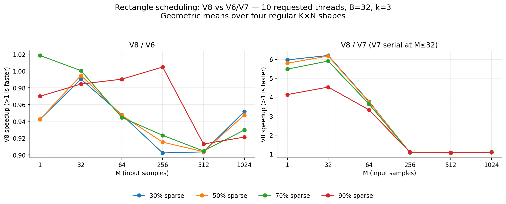
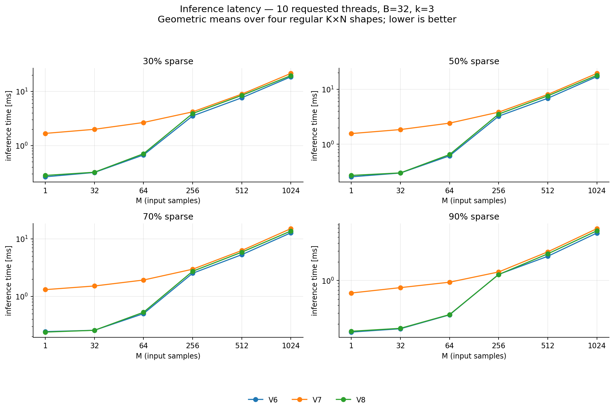

# SPR V6 / V7 / V8: 10-thread comparison

[Interpretation and matched-pattern comparisons](interpretation.md)

machdep.cpu.brand_string: Apple M4 Pro  
hw.physicalcpu: 14  
hw.perflevel0.physicalcpu: 10  
hw.perflevel1.physicalcpu: 4  
hw.cachelinesize: 128  
hw.perflevel0.l1dcachesize: 131072  
hw.perflevel0.l2cachesize: 16777216  
hw.perflevel0.cpusperl2: 5  
hw.perflevel1.l1dcachesize: 65536  
hw.perflevel1.l2cachesize: 4194304  

V6 uses static collapsed tile × group scheduling; V7 assigns whole M tiles; V8 dynamically schedules rectangles sized by estimated sparse-instruction work.
All three kernels are B=32. The primary results hold k=3 fixed across all versions, matrices and sparsities.
The secondary tuned comparison independently selects the fastest k in {2,3,4} for each version and workload; it does not isolate scheduling as strictly.

## Measurement method

- M: [1, 32, 64, 256, 512, 1024]; regular K×N: [(1024, 4096), (2048, 2048), (4096, 1024), (2048, 8192)]; sparsities: 30%, 50%, 70%, 90%.
- Additional K=1024, N=32 cases are reported separately from regular-matrix averages.
- Clustered diagnostic: M=[64, 256, 512, 1024], K×N=[(1024, 4096), (2048, 8192)]; floor(s*N) leading columns are zero, remaining columns dense random ±1.
- Identical seed-42 inputs and weights for each matching workload across versions and k values.
- 31 interleaved timed rounds, rotating configuration order, after 5 warmups. Medians are reported.
- Exactly 10 requested OpenMP threads; OMP_WAIT_POLICY=PASSIVE, KMP_BLOCKTIME=0, OMP_DYNAMIC=FALSE. macOS controls core placement.
- V7 runs serially at M=1 and M=32 because there is only one sample tile. Other cases can also use fewer than 10 useful workers.
- Preparation, input conversion and bind() are outside inference timing. V8 builds its reusable task plan in bind(). Thread-private scratch allocation remains inside inference for all versions.
- Correctness checks were explicitly skipped: no correctness suite, benchmark --verify none, --ref-rows 0. max_err=-1 means unchecked; ok=1 is not new correctness evidence.
- Fresh 10-thread machine ceilings are saved in peaks.json. No historical machine bandwidths are used.

## Primary results: fixed k=3

Geometric means over the four regular K×N shapes and four sparsity levels at each M. Speedup = baseline runtime / V8 runtime; >1 means V8 is faster.

| M | V6 [ms] | V7 [ms] | V8 [ms] | V8 / V6 | V8 / V7 |
|---|---|---|---|---|---|
| 1 | 0.2215 | 1.2109 | 0.2289 | 0.968× | 5.291× |
| 32 | 0.2524 | 1.4383 | 0.2543 | 0.992× | 5.657× |
| 64 | 0.4891 | 1.8467 | 0.5109 | 0.957× | 3.614× |
| 256 | 2.4517 | 2.8444 | 2.6205 | 0.936× | 1.085× |
| 512 | 5.1076 | 6.0109 | 5.6356 | 0.906× | 1.067× |
| 1024 | 12.3814 | 14.4202 | 13.2070 | 0.937× | 1.092× |

## Dependence on sparsity

| M | Sparsity | V8 / V6 | V8 / V7 |
|---|---|---|---|
| 1 | 30% | 0.943× | 5.968× |
| 1 | 50% | 0.943× | 5.792× |
| 1 | 70% | 1.019× | 5.480× |
| 1 | 90% | 0.970× | 4.137× |
| 32 | 30% | 0.990× | 6.200× |
| 32 | 50% | 0.995× | 6.169× |
| 32 | 70% | 1.000× | 5.907× |
| 32 | 90% | 0.984× | 4.532× |
| 64 | 30% | 0.948× | 3.768× |
| 64 | 50% | 0.947× | 3.742× |
| 64 | 70% | 0.945× | 3.636× |
| 64 | 90% | 0.990× | 3.329× |
| 256 | 30% | 0.902× | 1.072× |
| 256 | 50% | 0.915× | 1.084× |
| 256 | 70% | 0.923× | 1.086× |
| 256 | 90% | 1.005× | 1.100× |
| 512 | 30% | 0.904× | 1.056× |
| 512 | 50% | 0.904× | 1.062× |
| 512 | 70% | 0.905× | 1.070× |
| 512 | 90% | 0.913× | 1.078× |
| 1024 | 30% | 0.952× | 1.100× |
| 1024 | 50% | 0.948× | 1.085× |
| 1024 | 70% | 0.930× | 1.099× |
| 1024 | 90% | 0.921× | 1.083× |

## Pattern and tuning diagnostics

| Dataset | Points | V8 / V6 | V8 / V7 |
|---|---|---|---|
| Random zeros, regular shapes, fixed k=3 | 96 | 0.949× | 2.270× |
| Clustered zero columns, fixed k=3 | 32 | 1.211× | 1.445× |
| Narrow N=32, fixed k=3 | 24 | 1.496× | 1.034× |
| Random zeros, regular shapes, independently tuned k | 96 | 0.976× | 2.227× |

Clustered and narrow results are deliberately excluded from the main regular-matrix averages.
The clustered pattern is synthetic; it demonstrates sensitivity to unequal group work, rather than predicting all structured-sparsity workloads.
Task counts in comparison.csv are inferred from V8's extra metadata bytes: four 32-bit ints per Task. The underlying instruction streams perform the same addition count at matching k.
Near-unity differences can reflect measurement noise. This is one timing campaign with one deterministic weight sample per workload; no confidence intervals are claimed.
Roofline intensity uses compulsory instruction-format + X + Y bytes, including V8 task descriptors. It is not measured cache traffic or a direct measure of cache reuse.

## Plots and data

- [V8 speedup vs V6 and V7](speedup.png)
- [Absolute runtime](runtime.png)
- [V8 vs V6 by matrix shape](matrix_speedup.png)
- [Random vs clustered zeros](pattern_speedup.png)
- [Narrow-output absolute runtime](narrow_runtime.png)
- [Roofline](roofline.png)
- Per-size runtime curves: [M=1](runtime_M1.png), [M=32](runtime_M32.png), [M=64](runtime_M64.png), [M=256](runtime_M256.png), [M=512](runtime_M512.png), [M=1024](runtime_M1024.png)
- comparison.csv: fixed k=3; all_k_comparison.csv: all matching k; tuned_comparison.csv: independently fastest k; raw.csv: all timing configurations.

