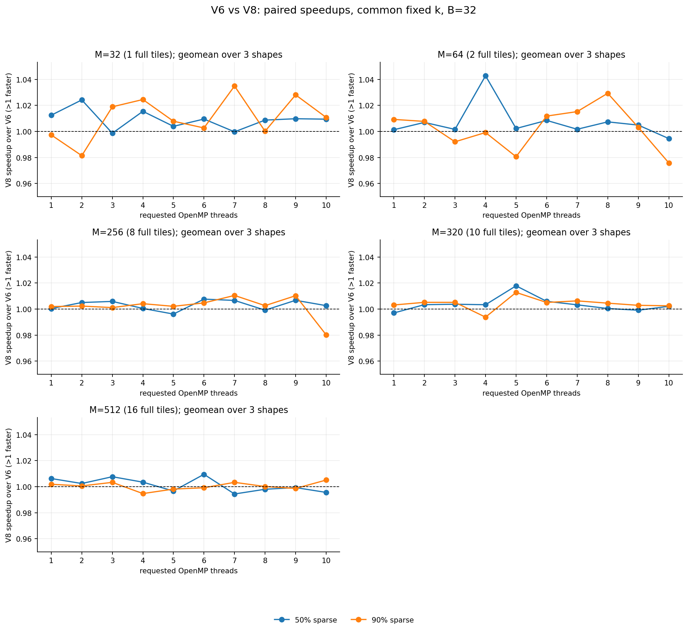
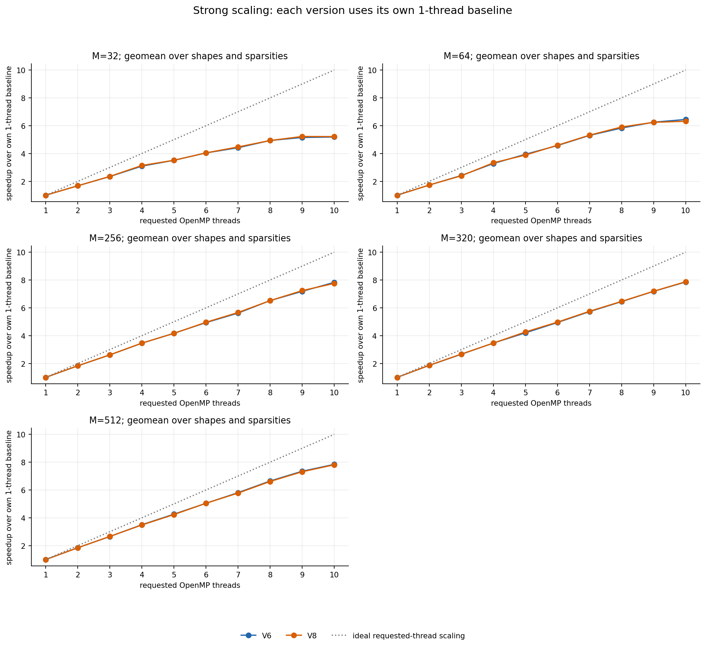
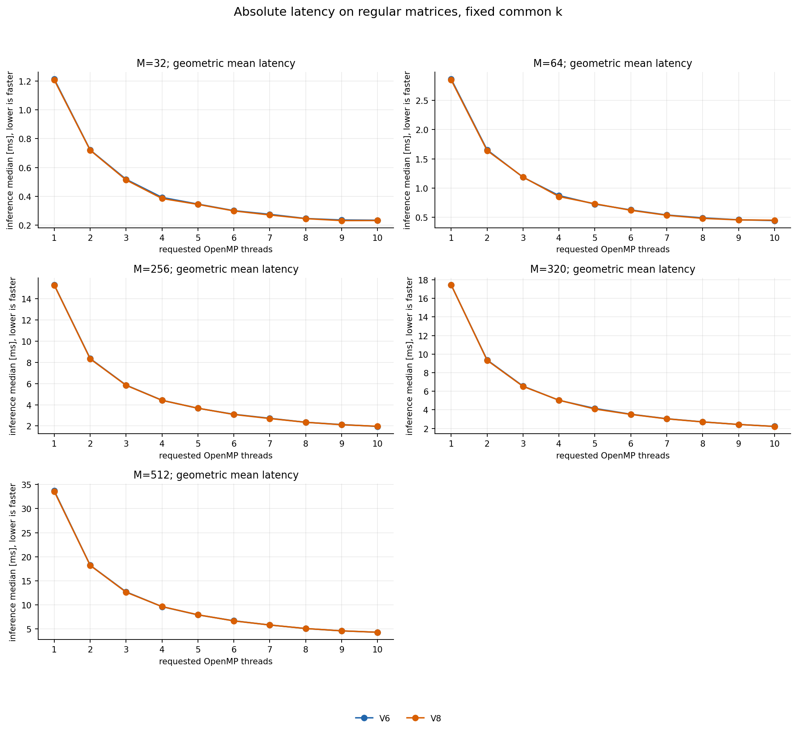
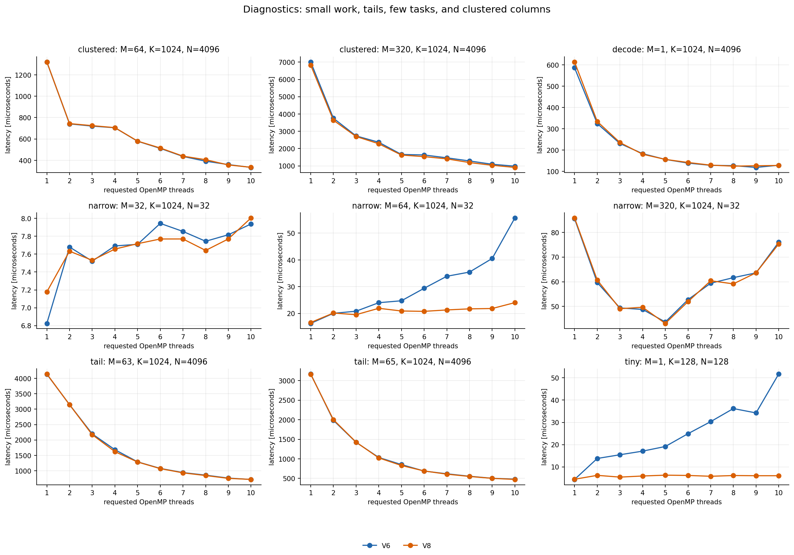
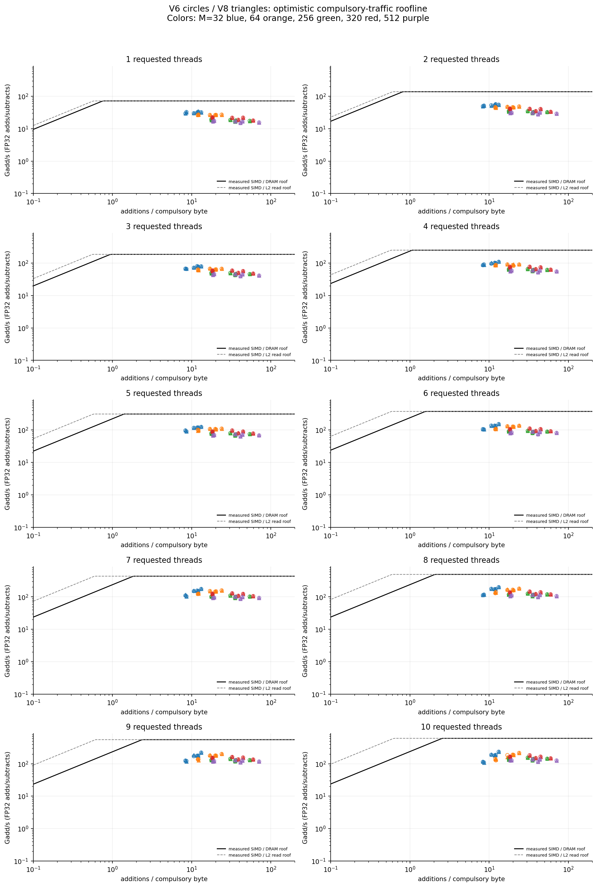

# SPR V6 versus V8: 1–10 thread benchmarks

Measured 2026-11-14T10:39:48.248295+01:00. Both versions use B=32 and identical deterministic inputs/weights (seed 42). Correctness checks were **not run**, as requested.

## Findings

- **Regular matrices are effectively tied:** V8/V6 geometric-mean speedup ranges from 0.998× to 1.008× across all ten thread counts. At ten threads it is 0.998×.
- **Small-work overhead improves:** at ten requested threads the tiny M=1,K=N=128 case drops from 51.8 to 6.0 microseconds (8.57×). Narrow M=64 cases also benefit; see the diagnostic table.
- **Scaling is similar:** at ten threads the regular-grid speedup over one thread is 6.94× for V6 and 6.91× for V8, about 69% nominal efficiency.
- **Roofline points mostly overlap:** this run shows no general throughput uplift from switching scheduling. The work, format, and estimated arithmetic intensity are identical at a common k.

## Setup

machdep.cpu.brand_string: Apple M4 Pro  
hw.physicalcpu: 14  
hw.logicalcpu: 14  
hw.perflevel0.physicalcpu: 10  
hw.perflevel1.physicalcpu: 4  
hw.cachelinesize: 128  
hw.perflevel0.l1dcachesize: 131072  
hw.perflevel0.l2cachesize: 16777216  

Exactly 10 requested thread counts: [1, 2, 3, 4, 5, 6, 7, 8, 9, 10]. Main grid: M=[32, 64, 256, 320, 512]; K×N=[(1024, 4096), (4096, 1024), (2048, 8192)]; sparsity=[0.5, 0.9]; k sweep=[2, 3, 4].

2,700 timed configurations × 21 rounds = 56,700 timed inference calls, after three warmups per configuration. Kernels are timed interleaved with rotating order; benchmarks and ceiling calibration run sequentially.

Preparation, layout conversion/bind, and any finish operation are outside inference timing. We run `bench_cpu --verify none`; `max_err=-1` means unchecked, and `ok=1` in raw data must not be interpreted as verification.

Compiled with the repository Release flags: Apple Clang, `-O3 -ffast-math -DNDEBUG -mcpu=native` and Homebrew OpenMP. Sources and binary hashes are saved in the run directory.

OMP_DYNAMIC=FALSE, OMP_WAIT_POLICY=PASSIVE, KMP_BLOCKTIME=0. Binding to cores was requested; macOS placement is not guaranteed (the preceding investigation reported zero available OpenMP places). Requested threads are not necessarily active V8 workers.

Main comparisons select V6’s fastest k at one thread once per workload, then hold that same k for both versions and every thread count. Independently tuned results are saved separately in `tuned_comparison.csv`. This isolates scheduling rather than mixing per-thread k choices.

This is one campaign on a shared laptop, using one random weight sample per workload. Small differences around unity can be noise; medians are not confidence intervals. Minima and per-configuration round counts are preserved in raw data.

## Speedup and scaling

`V8/V6 speedup = time(V6,t) / time(V8,t)`; values above one favor V8. Each version’s scaling is its own one-thread time divided by its t-thread time. Nominal efficiency divides that scaling by the requested thread count. Regular-grid summaries are geometric means with equal weight per workload; diagnostics are excluded.

| Threads | V8/V6 speedup | V6 scaling | V8 scaling | V6 efficiency | V8 efficiency |
|---:|---:|---:|---:|---:|---:|
| 1 | 1.003× | 1.00× | 1.00× | 100% | 100% |
| 2 | 1.004× | 1.79× | 1.79× | 89% | 90% |
| 3 | 1.004× | 2.53× | 2.54× | 84% | 85% |
| 4 | 1.008× | 3.36× | 3.37× | 84% | 84% |
| 5 | 1.002× | 4.01× | 4.00× | 80% | 80% |
| 6 | 1.006× | 4.69× | 4.71× | 78% | 78% |
| 7 | 1.008× | 5.35× | 5.37× | 76% | 77% |
| 8 | 1.005× | 6.04× | 6.05× | 76% | 76% |
| 9 | 1.006× | 6.57× | 6.59× | 73% | 73% |
| 10 | 0.998× | 6.94× | 6.91× | 69% | 69% |

### Speedup by batch size

| Threads | M=32 | M=64 | M=256 | M=320 | M=512 |
|---:|---:|---:|---:|---:|---:|
| 1 | 1.005× | 1.005× | 1.001× | 1.000× | 1.004× |
| 2 | 1.003× | 1.007× | 1.004× | 1.004× | 1.002× |
| 3 | 1.009× | 0.997× | 1.004× | 1.004× | 1.005× |
| 4 | 1.020× | 1.021× | 1.002× | 0.999× | 0.999× |
| 5 | 1.006× | 0.991× | 0.999× | 1.015× | 0.997× |
| 6 | 1.006× | 1.010× | 1.006× | 1.006× | 1.004× |
| 7 | 1.017× | 1.008× | 1.009× | 1.005× | 0.999× |
| 8 | 1.004× | 1.018× | 1.001× | 1.002× | 0.999× |
| 9 | 1.019× | 1.004× | 1.008× | 1.001× | 0.999× |
| 10 | 1.010× | 0.985× | 0.991× | 1.002× | 1.000× |

## Interpretation

V8 caps its requested team by available tasks and floor(estimated additions / 32768), with a minimum of one worker. It uses tile-only scheduling only for full tiles with at least 90% wave efficiency; otherwise it retains static collapsed tile/group scheduling.

At B=32, M=32/64/256/320/512 expose 1/2/8/10/16 tiles. At ten active workers, M=320 has a perfect tile wave; M=256 and M=512 fall back to 2D. Many divisible cases already give V6 whole tiles under static collapse, so the V8 policy need not produce large gains there.

On the regular grid at ten requested threads, V8/V6 is **0.998×** (geometric mean). Across all 45 fixed-k workloads at ten threads, 5 favor V8 by more than 5%, 2 favor V6 by more than 5%, and 38 lie between those thresholds. These are descriptive counts, not significance tests.

The largest gains should be read together with absolute diagnostic latency: avoiding excessive workers on a tiny problem can yield a large ratio without saving much absolute time. Tail and clustered-column cases still use static scheduling; V8 does not implement the dynamic/guided scheduling, stride padding, or full-tile padding explored in the earlier report.

### Diagnostic workloads at 10 requested threads

| Category | M | K×N | Sparsity | Common k | V6 ms | V8 ms | V8/V6 |
|---|---:|---|---:|---|---:|---:|---:|
| clustered | 64 | 1024×4096 | 50% | k=4 | 0.3335 | 0.3345 | 1.00× |
| clustered | 320 | 1024×4096 | 50% | k=4 | 0.9836 | 0.9121 | 1.08× |
| decode | 1 | 1024×4096 | 50% | k=4 | 0.1605 | 0.1575 | 1.02× |
| decode | 1 | 1024×4096 | 90% | k=4 | 0.1038 | 0.1042 | 1.00× |
| narrow | 32 | 1024×32 | 50% | k=2 | 0.0127 | 0.0127 | 1.00× |
| narrow | 32 | 1024×32 | 90% | k=2 | 0.0050 | 0.0050 | 0.98× |
| narrow | 64 | 1024×32 | 50% | k=3 | 0.0497 | 0.0285 | 1.74× |
| narrow | 64 | 1024×32 | 90% | k=2 | 0.0624 | 0.0203 | 3.08× |
| narrow | 320 | 1024×32 | 50% | k=4 | 0.0811 | 0.0807 | 1.00× |
| narrow | 320 | 1024×32 | 90% | k=2 | 0.0713 | 0.0703 | 1.01× |
| tail | 63 | 1024×4096 | 50% | k=4 | 1.1211 | 1.1244 | 1.00× |
| tail | 63 | 1024×4096 | 90% | k=2 | 0.4598 | 0.4589 | 1.00× |
| tail | 65 | 1024×4096 | 50% | k=4 | 0.8215 | 0.8202 | 1.00× |
| tail | 65 | 1024×4096 | 90% | k=2 | 0.2826 | 0.2740 | 1.03× |
| tiny | 1 | 128×128 | 50% | k=2 | 0.0517 | 0.0060 | 8.57× |

## Roofline comparison

Fresh local ceilings were measured using `build/peaks --threads t` for **each** t=1…10. Compute ceilings count FP32 additions, not FMA throughput; bandwidth ceilings are the existing streaming read microbenchmarks. These are empirical microbenchmark ceilings, not guaranteed strict bounds for every access pattern.

The plotted operation count follows the existing kernel accounting: `A = M * adds_per_row()`. Subtractions count as one arithmetic operation; clears, stores, integer/index work, and control flow are excluded. `performance = A / (median_ms * 10^6)` Gadd/s.

Intensity is **A / (compressed-format bytes + 4*M*(K+N))**, the optimistic compulsory-byte convention used by the repository. Both versions have identical metadata and arithmetic counts at common k, so each V6/V8 pair shares the same horizontal position; scheduling changes its vertical performance.

The black roof is min(measured SIMD-add throughput, intensity × measured DRAM-read bandwidth); the dashed gray roof substitutes L2-read bandwidth. Regular-grid workloads only are plotted, one panel per requested thread count.

Metadata is actually traversed per batch tile, and X/scratch/Y traffic can repeat through caches. The intensity estimate does not measure actual DRAM traffic, write allocation, coherence, or cache misses. Distance below a roof is headroom, not proof of a particular bottleneck; these plots alone cannot establish “DRAM-bound” versus “compute-bound.” V8 can reduce its active team, so requested-thread ceilings may overstate the resources it uses.

| Requested threads | SIMD add peak Gadd/s | L1 read GB/s | L2 read GB/s | DRAM read GB/s |
|---:|---:|---:|---:|---:|
| 1 | 71.8 | 206.2 | 125.4 | 95.1 |
| 2 | 138.1 | 377.6 | 228.3 | 169.6 |
| 3 | 186.6 | 549.7 | 333.4 | 198.2 |
| 4 | 251.3 | 728.5 | 438.1 | 235.8 |
| 5 | 311.6 | 893.3 | 541.5 | 222.7 |
| 6 | 374.7 | 1041.1 | 642.2 | 239.3 |
| 7 | 435.4 | 1190.1 | 734.6 | 237.5 |
| 8 | 494.1 | 1315.8 | 833.4 | 238.9 |
| 9 | 554.0 | 1458.7 | 908.7 | 234.3 |
| 10 | 609.0 | 1593.2 | 976.0 | 238.3 |

## Per-shape results at 10 threads

| M | K×N | V6 ms (geomean over sparsities) | V8 ms | V8/V6 |
|---:|---|---:|---:|---:|
| 32 | 1024×4096 | 0.169 | 0.165 | 1.022× |
| 32 | 4096×1024 | 0.166 | 0.167 | 0.992× |
| 32 | 2048×8192 | 0.456 | 0.449 | 1.017× |
| 64 | 1024×4096 | 0.294 | 0.295 | 0.996× |
| 64 | 4096×1024 | 0.310 | 0.301 | 1.028× |
| 64 | 2048×8192 | 0.960 | 1.028 | 0.934× |
| 256 | 1024×4096 | 1.278 | 1.270 | 1.007× |
| 256 | 4096×1024 | 1.257 | 1.299 | 0.968× |
| 256 | 2048×8192 | 4.648 | 4.647 | 1.000× |
| 320 | 1024×4096 | 1.436 | 1.423 | 1.009× |
| 320 | 4096×1024 | 1.443 | 1.432 | 1.008× |
| 320 | 2048×8192 | 5.269 | 5.323 | 0.990× |
| 512 | 1024×4096 | 2.708 | 2.685 | 1.008× |
| 512 | 4096×1024 | 2.796 | 2.781 | 1.006× |
| 512 | 2048×8192 | 10.492 | 10.627 | 0.987× |

## Reproduction and data

Build: `cmake --build build --target bench_cpu peaks -j 4`. Run: `/usr/bin/python3 bench/compare_v6_v8.py`. Replot: `/usr/bin/python3 bench/compare_v6_v8.py --plots-only results/20261114-103948_spr_v6_v8_threads_1_10`.

No correctness command is invoked by this script; every kernel benchmark explicitly passes `--verify none`.

- [manifest.json](manifest.json): complete jobs, environment, flags context, source/binary hashes.
- [raw.csv](raw.csv): all k values and requested threads; unchecked results marked max_err=-1.
- [comparison.csv](comparison.csv): fixed common-k paired times, scaling, efficiency, roofline coordinates.
- [tuned_comparison.csv](tuned_comparison.csv): independently best k per version and thread count.
- [thread_summary.csv](thread_summary.csv): regular-grid aggregates.
- `t01` … `t10`: benchmark logs, raw CSVs, and freshly measured ceilings.
- `source/`: source snapshots, including the comparison script. No kernel changes were made for this campaign.

Earlier bottleneck investigation: [previous report](../v6_investigation/report.md). CSV files remain subject to the repository’s existing `*.csv` ignore rule.
