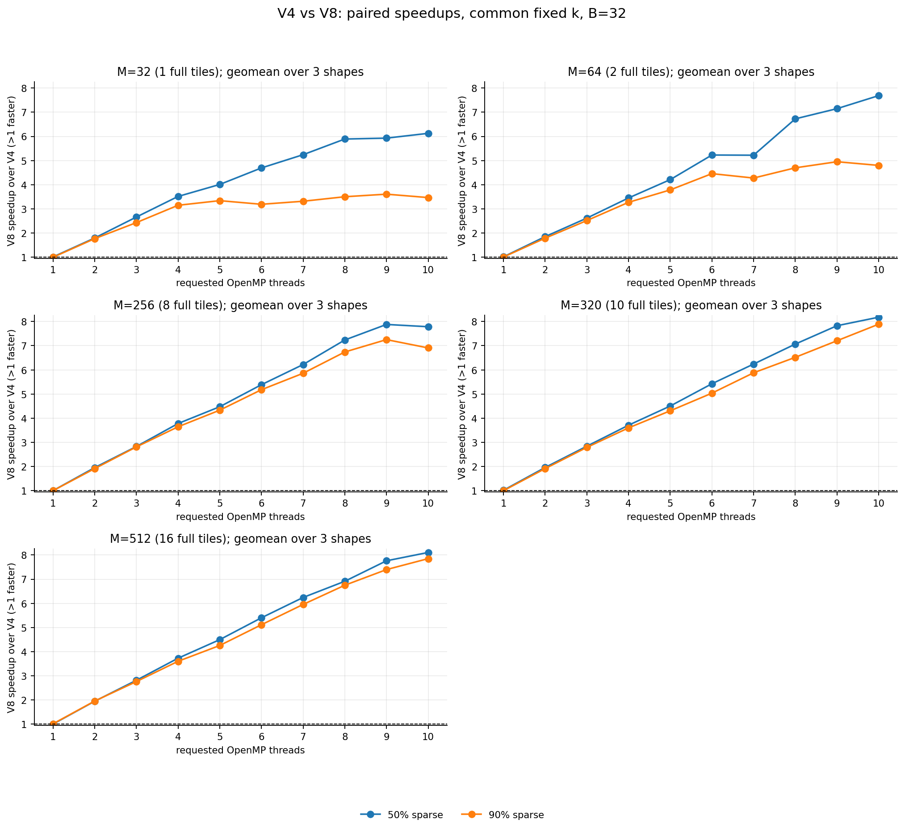
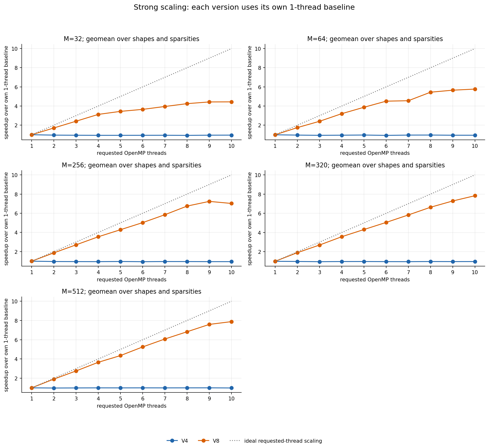
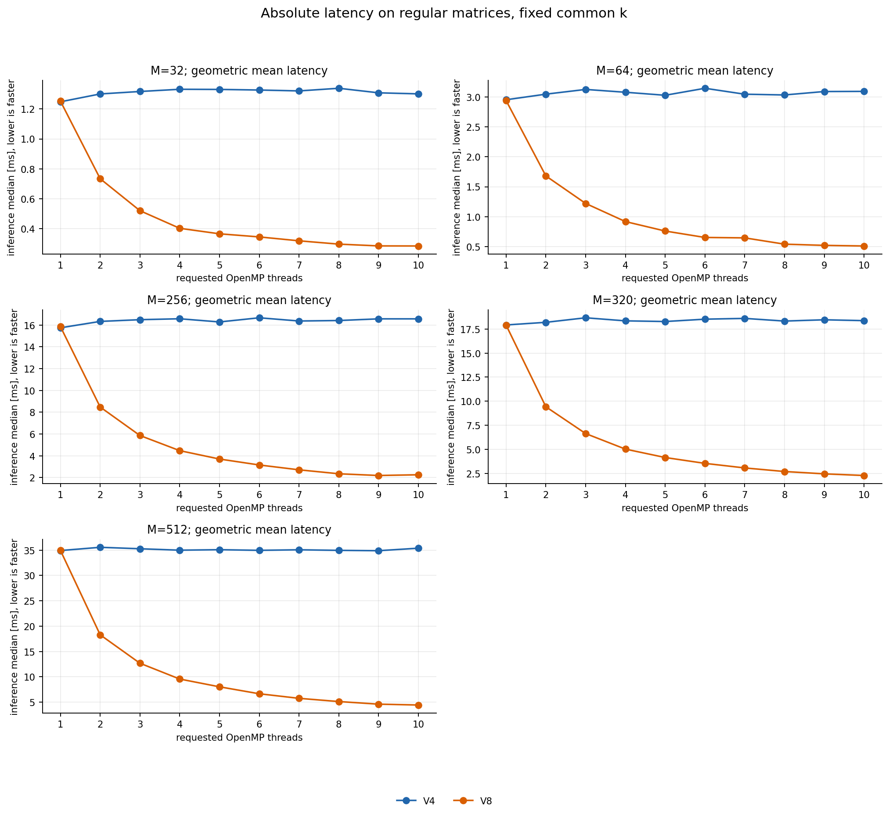
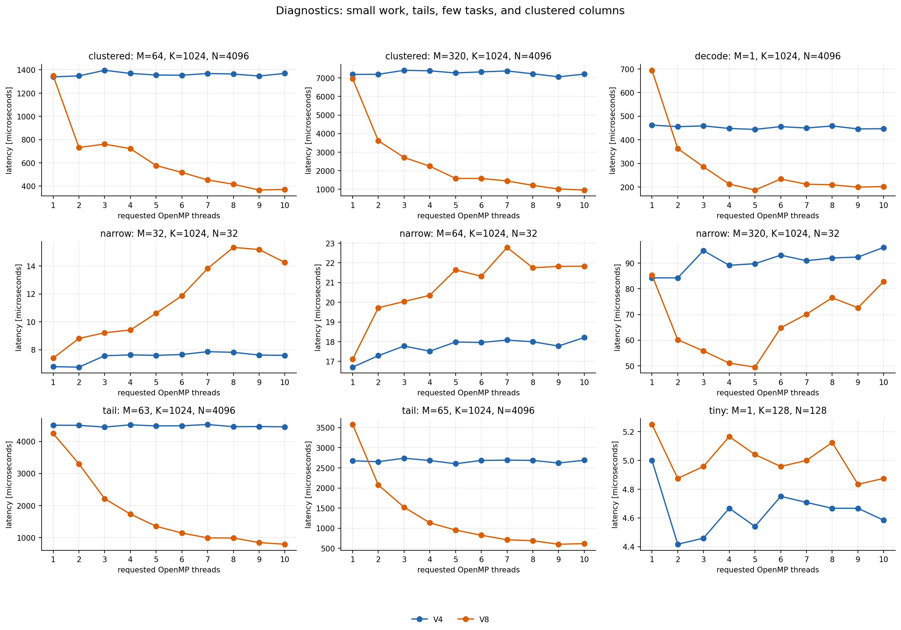
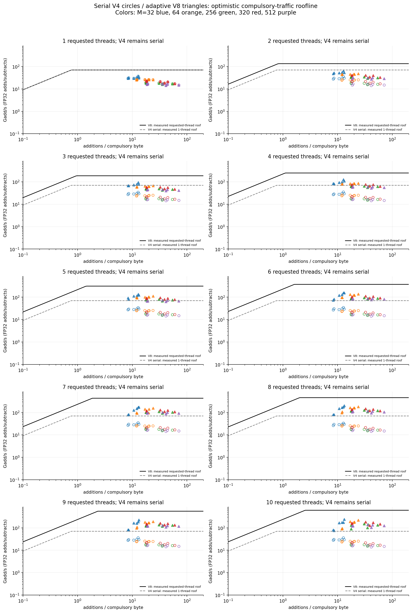

# SPR V4 versus V8: 1–10 thread benchmarks

Measured 2026-11-14T11:27:10.608780+01:00. Both versions use B=32 and identical deterministic inputs/weights (seed 42). Correctness checks were **not run**, as requested.

## Findings

- **Measured regular-matrix speedup:** V8/V4 geometric-mean speedup ranges from 0.999× to 6.665× across all ten thread counts. At ten threads it is 6.665×.
- **Tiny workload:** at ten requested threads the M=1,K=N=128 case takes 4.6 and 4.9 microseconds for V4 and V8 respectively (0.94× V8/V4). See the diagnostic table for narrow outputs and tails.
- **Scaling versus own one-thread baseline:** at ten requested threads the regular-grid ratio is 0.97× for V4 and 6.44× for V8, about 64% nominal efficiency.
- **This compares serial V4 with parallel V8.** Their arithmetic count agrees at common k, but V8 adds group-offset metadata and changes scratch allocation. Use the one-thread comparison to assess serial overhead; multi-thread speedup also includes parallel execution.

## Setup

machdep.cpu.brand_string: Apple M4 Pro  
hw.physicalcpu: 14  
hw.logicalcpu: 14  
hw.perflevel0.physicalcpu: 10  
hw.perflevel1.physicalcpu: 4  
hw.cachelinesize: 128  
hw.perflevel0.l1dcachesize: 131072  
hw.perflevel0.l2cachesize: 16777216  

Exactly 10 requested thread counts: [1, 2, 3, 4, 5, 6, 7, 8, 9, 10]. Main grid: M=[32, 64, 256, 320, 512]; K×N=[(1024, 4096), (4096, 1024), (2048, 8192)]; sparsity=[0.5, 0.9]; k sweep=[2, 3, 4].

2,700 timed configurations × 21 rounds = 56,700 timed inference calls, after three warmups per configuration. Kernels are timed interleaved with rotating order; benchmarks and ceiling calibration run sequentially.

Preparation, layout conversion/bind, and any finish operation are outside inference timing. We run `bench_cpu --verify none`; `max_err=-1` means unchecked, and `ok=1` in raw data must not be interpreted as verification.

Compiled with the repository Release flags: Apple Clang, `-O3 -ffast-math -DNDEBUG -mcpu=native` and Homebrew OpenMP. Sources and binary hashes are saved in the run directory.

OMP_DYNAMIC=FALSE, OMP_WAIT_POLICY=PASSIVE, KMP_BLOCKTIME=0. Binding to cores was requested; macOS placement is not guaranteed (the preceding investigation reported zero available OpenMP places). Requested threads are not necessarily active V8 workers.

Main comparisons select V4’s fastest k at one thread once per workload, then hold that same k for both versions and every thread count. Independently tuned results are saved separately in `tuned_comparison.csv`. This holds the algorithm parameter constant; the comparison includes parallelism, scratch-lifetime changes, and group-offset metadata.

This is one campaign on a shared laptop, using one random weight sample per workload. Small differences around unity can be noise; medians are not confidence intervals. Minima and per-configuration round counts are preserved in raw data.

## Speedup and scaling

`V8/V4 speedup = time(V4,t) / time(V8,t)`; values above one favor V8. Each version’s scaling is its own one-thread time divided by its t-thread time. Nominal efficiency divides that scaling by the requested thread count; for serial V4 this is a normalization only, not utilization of a parallel team. Regular-grid summaries are geometric means with equal weight per workload; diagnostics are excluded.

| Threads | V8/V4 speedup | V4 scaling | V8 scaling | V4 efficiency | V8 efficiency |
|---:|---:|---:|---:|---:|---:|
| 1 | 0.999× | 1.00× | 1.00× | 100% | 100% |
| 2 | 1.877× | 0.97× | 1.83× | 49% | 91% |
| 3 | 2.698× | 0.96× | 2.59× | 32% | 86% |
| 4 | 3.535× | 0.96× | 3.41× | 24% | 85% |
| 5 | 4.152× | 0.97× | 4.04× | 19% | 81% |
| 6 | 4.857× | 0.96× | 4.66× | 16% | 78% |
| 7 | 5.349× | 0.97× | 5.18× | 14% | 74% |
| 8 | 6.072× | 0.97× | 5.89× | 12% | 74% |
| 9 | 6.525× | 0.97× | 6.31× | 11% | 70% |
| 10 | 6.665× | 0.97× | 6.44× | 10% | 64% |

### Speedup by batch size

| Threads | M=32 | M=64 | M=256 | M=320 | M=512 |
|---:|---:|---:|---:|---:|---:|
| 1 | 0.996× | 1.005× | 0.993× | 1.001× | 0.999× |
| 2 | 1.775× | 1.814× | 1.927× | 1.931× | 1.944× |
| 3 | 2.539× | 2.562× | 2.814× | 2.811× | 2.782× |
| 4 | 3.322× | 3.356× | 3.706× | 3.650× | 3.659× |
| 5 | 3.656× | 3.989× | 4.398× | 4.400× | 4.370× |
| 6 | 3.866× | 4.826× | 5.278× | 5.224× | 5.253× |
| 7 | 4.165× | 4.722× | 6.035× | 6.055× | 6.094× |
| 8 | 4.539× | 5.620× | 6.983× | 6.787× | 6.829× |
| 9 | 4.622× | 5.948× | 7.560× | 7.510× | 7.576× |
| 10 | 4.606× | 6.073× | 7.334× | 8.034× | 7.977× |

## Interpretation

V8 caps its requested team by available tasks and floor(estimated additions / 32768), with a minimum of one worker. It uses tile-only scheduling only for full tiles with at least 90% wave efficiency; otherwise it retains static collapsed tile/group scheduling.

V4 has no OpenMP inference region: it processes every tile and group sequentially, using scratch allocated in prepare(). Its t-thread measurements remain serial. Differences between those V4 measurements reflect placement, cache/runtime context, or drift rather than parallel scaling. V8 allocates scratch per participating worker per run and uses read-only group offsets for independent tasks.

At B=32, M=32/64/256/320/512 expose 1/2/8/10/16 tiles. At ten active workers, M=320 has a perfect tile wave; M=256 and M=512 fall back to 2D. V8 can also parallelize output groups when there are fewer tiles than workers.

On the regular grid at ten requested threads, V8/V4 is **6.665×** (geometric mean). Across all 45 fixed-k workloads at ten threads, 40 favor V8 by more than 5%, 4 favor V4 by more than 5%, and 1 lie between those thresholds. These are descriptive counts, not significance tests.

The tiny case need not favor V8: V4 is already serial and reuses scratch, while V8 still evaluates its policy and enters a serialized OpenMP region when P*=1. Tail and clustered-column cases use static scheduling in V8; it does not implement dynamic/guided scheduling, stride padding, or full-tile padding.

### Diagnostic workloads at 10 requested threads

| Category | M | K×N | Sparsity | Common k | V4 ms | V8 ms | V8/V4 |
|---|---:|---|---:|---|---:|---:|---:|
| clustered | 64 | 1024×4096 | 50% | k=4 | 1.3696 | 0.3711 | 3.69× |
| clustered | 320 | 1024×4096 | 50% | k=4 | 7.2051 | 0.9604 | 7.50× |
| decode | 1 | 1024×4096 | 50% | k=2 | 0.6620 | 0.2507 | 2.64× |
| decode | 1 | 1024×4096 | 90% | k=2 | 0.3019 | 0.1631 | 1.85× |
| narrow | 32 | 1024×32 | 50% | k=4 | 0.0128 | 0.0447 | 0.29× |
| narrow | 32 | 1024×32 | 90% | k=2 | 0.0045 | 0.0045 | 0.99× |
| narrow | 64 | 1024×32 | 50% | k=3 | 0.0317 | 0.0280 | 1.13× |
| narrow | 64 | 1024×32 | 90% | k=2 | 0.0105 | 0.0170 | 0.62× |
| narrow | 320 | 1024×32 | 50% | k=4 | 0.1687 | 0.1001 | 1.69× |
| narrow | 320 | 1024×32 | 90% | k=2 | 0.0548 | 0.0686 | 0.80× |
| tail | 63 | 1024×4096 | 50% | k=3 | 7.7976 | 1.2181 | 6.40× |
| tail | 63 | 1024×4096 | 90% | k=2 | 2.5453 | 0.5165 | 4.93× |
| tail | 65 | 1024×4096 | 50% | k=2 | 4.6342 | 1.1413 | 4.06× |
| tail | 65 | 1024×4096 | 90% | k=2 | 1.5614 | 0.3333 | 4.68× |
| tiny | 1 | 128×128 | 50% | k=2 | 0.0046 | 0.0049 | 0.94× |

## Roofline comparison

Fresh local ceilings were measured using `build/peaks --threads t` for **each** t=1…10. Compute ceilings count FP32 additions, not FMA throughput; bandwidth ceilings are the existing streaming read microbenchmarks. These are empirical microbenchmark ceilings, not guaranteed strict bounds for every access pattern.

The plotted operation count follows the existing kernel accounting: `A = M * adds_per_row()`. Subtractions count as one arithmetic operation; clears, stores, integer/index work, and control flow are excluded. `performance = A / (median_ms * 10^6)` Gadd/s.

Intensity is **A / (compressed-format bytes + 4*M*(K+N))**, the optimistic compulsory-byte convention used by the repository. Arithmetic counts agree at a common k. Each version uses its own reported format size: V8 includes group offsets that V4 does not store, so their horizontal coordinates can differ slightly. Scratch is excluded from the format-byte count for both versions.

The black roof uses the requested-thread SIMD/DRAM ceilings for V8. The dashed gray roof uses the measured one-thread SIMD/DRAM ceilings for serial V4 in every panel. Each roof is min(SIMD-add throughput, intensity × DRAM-read bandwidth). Regular-grid workloads only are plotted, one panel per requested thread count.

Metadata is actually traversed per batch tile, and X/scratch/Y traffic can repeat through caches. The intensity estimate does not measure actual DRAM traffic, write allocation, coherence, or cache misses. Distance below a roof is headroom, not proof of a particular bottleneck; these plots alone cannot establish “DRAM-bound” versus “compute-bound.” V8 can reduce its active team, so requested-thread ceilings may overstate the resources it uses.

| Requested threads | SIMD add peak Gadd/s | L1 read GB/s | L2 read GB/s | DRAM read GB/s |
|---:|---:|---:|---:|---:|
| 1 | 70.2 | 201.7 | 121.9 | 91.6 |
| 2 | 134.7 | 370.6 | 222.6 | 163.7 |
| 3 | 187.2 | 549.5 | 329.2 | 197.0 |
| 4 | 249.2 | 721.0 | 429.1 | 225.4 |
| 5 | 312.4 | 900.7 | 535.0 | 218.5 |
| 6 | 374.1 | 1059.1 | 645.3 | 230.8 |
| 7 | 435.2 | 1229.7 | 742.9 | 233.8 |
| 8 | 461.6 | 1311.4 | 817.2 | 228.0 |
| 9 | 553.8 | 1484.4 | 910.0 | 236.8 |
| 10 | 610.3 | 1576.0 | 1014.0 | 238.7 |

## Per-shape results at 10 threads

| M | K×N | V4 ms (geomean over sparsities) | V8 ms | V8/V4 |
|---:|---|---:|---:|---:|
| 32 | 1024×4096 | 0.851 | 0.227 | 3.747× |
| 32 | 4096×1024 | 0.787 | 0.208 | 3.787× |
| 32 | 2048×8192 | 3.295 | 0.478 | 6.888× |
| 64 | 1024×4096 | 2.042 | 0.388 | 5.259× |
| 64 | 4096×1024 | 1.905 | 0.360 | 5.290× |
| 64 | 2048×8192 | 7.611 | 0.945 | 8.050× |
| 256 | 1024×4096 | 10.862 | 1.597 | 6.801× |
| 256 | 4096×1024 | 10.192 | 1.481 | 6.880× |
| 256 | 2048×8192 | 41.082 | 4.873 | 8.430× |
| 320 | 1024×4096 | 11.834 | 1.584 | 7.473× |
| 320 | 4096×1024 | 11.459 | 1.426 | 8.034× |
| 320 | 2048×8192 | 45.668 | 5.286 | 8.639× |
| 512 | 1024×4096 | 22.495 | 2.786 | 8.074× |
| 512 | 4096×1024 | 22.093 | 2.994 | 7.379× |
| 512 | 2048×8192 | 89.122 | 10.458 | 8.522× |

## Reproduction and data

Build: `cmake --build build --target bench_cpu peaks -j 4`. Run: `/usr/bin/python3 bench/compare_v4_v8.py`. Replot: `/usr/bin/python3 bench/compare_v4_v8.py --plots-only results/20261114-112710_spr_v4_v8_threads_1_10`.

No correctness command is invoked by this script; every kernel benchmark explicitly passes `--verify none`.

- [manifest.json](manifest.json): complete jobs, environment, flags context, source/binary hashes.
- [raw.csv](raw.csv): all k values and requested threads; unchecked results marked max_err=-1.
- [comparison.csv](comparison.csv): fixed common-k paired times, scaling, efficiency, roofline coordinates.
- [tuned_comparison.csv](tuned_comparison.csv): independently best k per version and thread count.
- [thread_summary.csv](thread_summary.csv): regular-grid aggregates.
- `t01` … `t10`: benchmark logs, raw CSVs, and freshly measured ceilings.
- `source/`: source snapshots, including the comparison script. No kernel changes were made for this campaign.

Previous V6/V8 comparison: [report](../20261114-103948_spr_v6_v8_threads_1_10/report.md). Earlier bottleneck investigation: [report](../v6_investigation/report.md). CSV files remain subject to the repository’s existing `*.csv` ignore rule.
