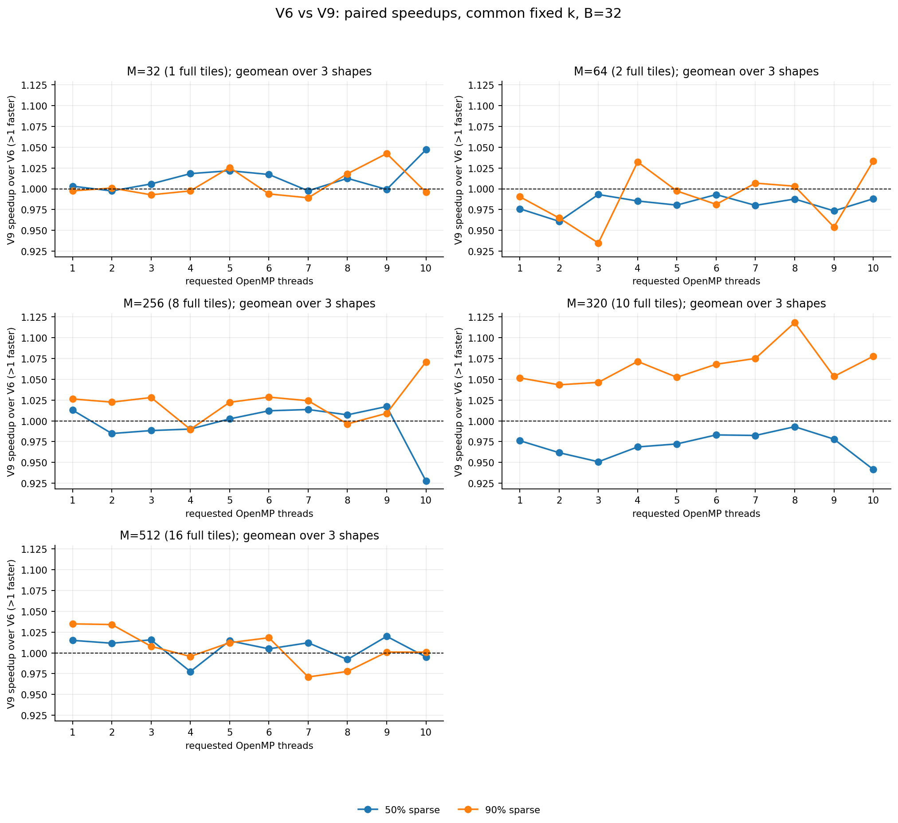
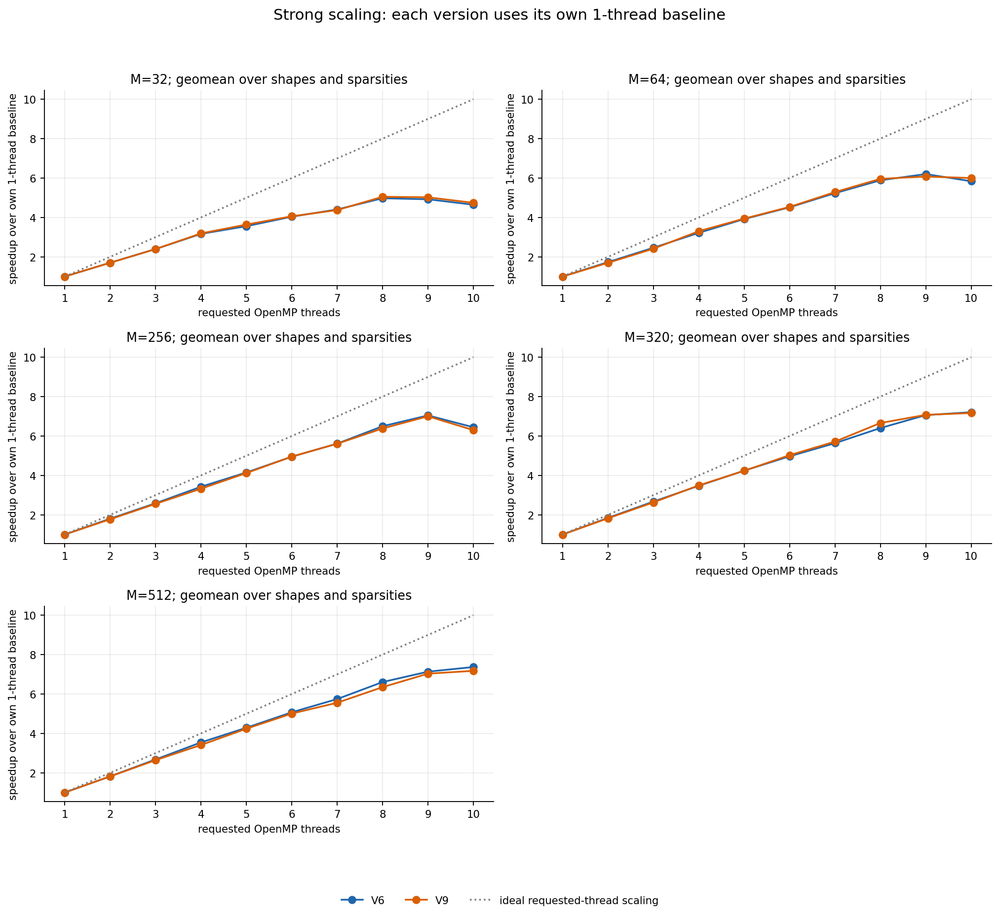
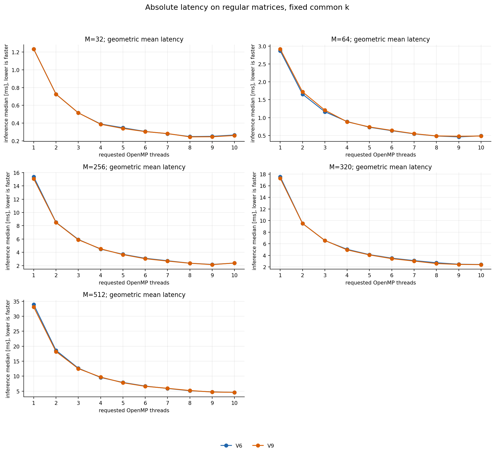
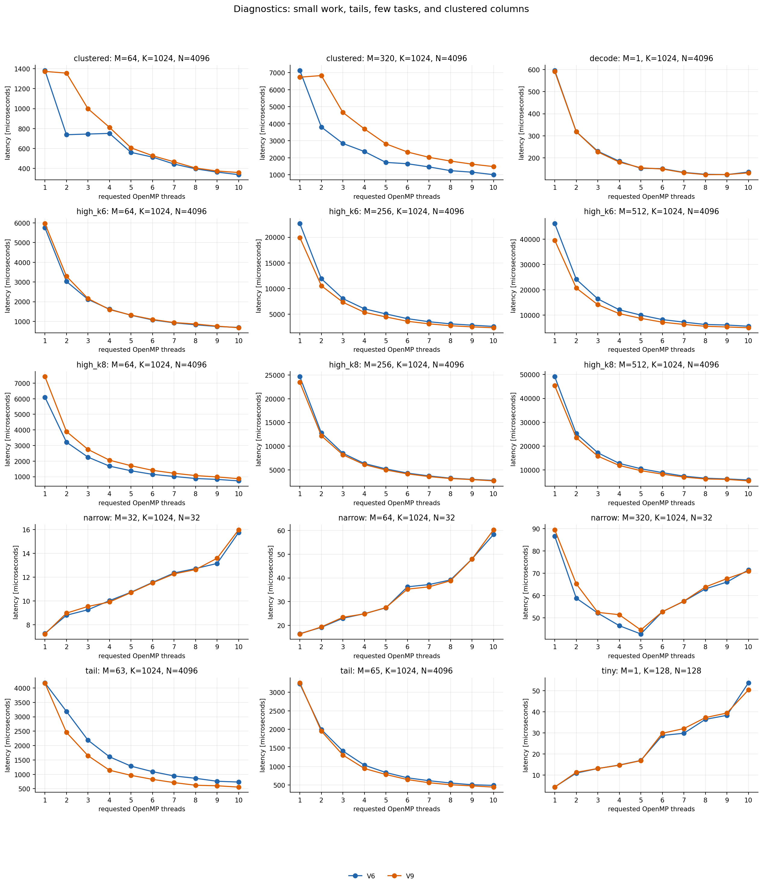
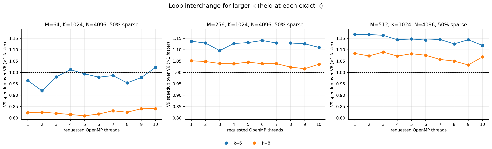
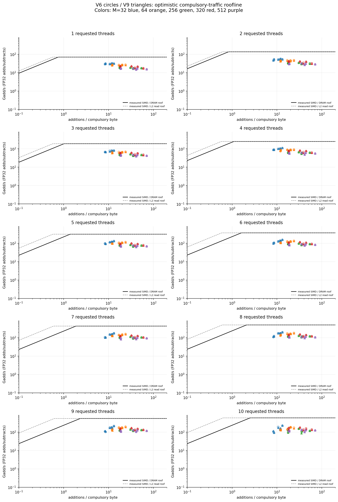

# SPR V6 versus V9: 1–10 thread benchmarks

Measured 2026-11-14T13:14:05.322038+01:00. Both versions use B=32 and identical deterministic inputs/weights (seed 42). Correctness checks were **not run**, as requested.

## Implementation

[V9 source](source/cpu/spr/spr_v9.cpp) copies V6 and interchanges only the two inference task loops. Preprocessing, process_group(), static collapse(2), scratch allocation, arithmetic and tile selection are unchanged. All matching B=16/B=32, L2 and fixed-Kc/G variants are registered; the benchmark measures the automatic-L1 B=32 variants.

## Findings

- **Regular-matrix loop-order comparison:** V9/V6 geometric-mean speedup ranges from 0.996× to 1.010× across all ten thread counts. At ten threads it is 1.007×.
- **Larger-k tradeoff:** at ten threads, M=64,k=8 gives 0.84× (V9 takes 1.19× as long), while M=512,k=6 gives 1.12×. Both use K=1024,N=4096,s=0.5.
- **Assignment matters:** at ten threads, the M=63,s=0.5 tail case gives 1.26×, but clustered columns at M=320 give 0.68× (V9 takes 1.47× as long). K=1024,N=4096; each uses its fixed common k.
- **Measured scaling:** at ten threads the regular-grid speedup over one thread is 6.22× for V6 and 6.21× for V9, about 62% nominal efficiency.
- **Only task traversal order changes.** V6 traverses tiles then groups; V9 traverses groups then tiles. Both retain static collapse(2), the same OpenMP team condition, scratch lifetime, preprocessing and arithmetic. Roofline pairs have the same estimated intensity.

## Setup

machdep.cpu.brand_string: Apple M4 Pro  
hw.physicalcpu: 14  
hw.logicalcpu: 14  
hw.perflevel0.physicalcpu: 10  
hw.perflevel1.physicalcpu: 4  
hw.cachelinesize: 128  
hw.perflevel0.l1dcachesize: 131072  
hw.perflevel0.l2cachesize: 16777216  

Exactly 10 requested thread counts: [1, 2, 3, 4, 5, 6, 7, 8, 9, 10]. Main grid: M=[32, 64, 256, 320, 512]; K×N=[(1024, 4096), (4096, 1024), (2048, 8192)]; sparsity=[0.5, 0.9]; k sweep=[2, 3, 4].

2,820 timed configurations × 21 rounds = 59,220 timed inference calls, after three warmups per configuration. Kernels are timed interleaved with rotating order; benchmarks and ceiling calibration run sequentially.

The primary grid uses k=2/3/4. Additional diagnostics hold k=6 and k=8 separately at M=64/256/512 and K=1024,N=4096,s=0.5. Kernels are spr.v6.b32 and spr.v9.b32 with automatic L1 cache tiling.

Regular and most diagnostic weights are IID ternary, with P(0)=s and equal probabilities for +/-1. The clustered diagnostic instead zeroes floor(s*N) leading columns and fills the remaining columns with dense +/-1 weights. It is deliberately uneven and excluded from regular-grid means.

Preparation, layout conversion/bind, and any finish operation are outside inference timing. We run `bench_cpu --verify none`; `max_err=-1` means unchecked, and `ok=1` in raw data must not be interpreted as verification.

Compiled with the repository Release flags: Apple Clang, `-O3 -ffast-math -DNDEBUG -mcpu=native` and Homebrew OpenMP. Sources and binary hashes are saved in the run directory.

OMP_DYNAMIC=FALSE, OMP_WAIT_POLICY=PASSIVE, KMP_BLOCKTIME=0. Binding to cores was requested; macOS placement is not guaranteed (the preceding investigation reported zero available OpenMP places). Both versions request the same OpenMP team when there is more than one task; no adaptive team limit is used.

Main comparisons select V6’s fastest k at one thread once per workload, then hold that same k for both versions and every thread count. Independently tuned results are saved separately in `tuned_comparison.csv`. This isolates scheduling rather than mixing per-thread k choices.

This is one campaign on a shared laptop, using one random weight sample per workload. Small differences around unity can be noise; medians are not confidence intervals. Minima and per-configuration round counts are preserved in raw data.

## Speedup and scaling

`V9/V6 speedup = time(V6,t) / time(V9,t)`; values above one favor V9. Each version’s scaling is its own one-thread time divided by its t-thread time. Nominal efficiency divides that scaling by the requested thread count. Regular-grid summaries are geometric means with equal weight per workload; diagnostics are excluded.

| Threads | V9/V6 speedup | V6 scaling | V9 scaling | V6 efficiency | V9 efficiency |
|---:|---:|---:|---:|---:|---:|
| 1 | 1.008× | 1.00× | 1.00× | 100% | 100% |
| 2 | 0.998× | 1.78× | 1.76× | 89% | 88% |
| 3 | 0.996× | 2.56× | 2.52× | 85% | 84% |
| 4 | 1.002× | 3.36× | 3.34× | 84% | 84% |
| 5 | 1.010× | 4.02× | 4.03× | 80% | 81% |
| 6 | 1.010× | 4.69× | 4.70× | 78% | 78% |
| 7 | 1.005× | 5.30× | 5.28× | 76% | 75% |
| 8 | 1.010× | 6.04× | 6.05× | 76% | 76% |
| 9 | 1.004× | 6.41× | 6.39× | 71% | 71% |
| 10 | 1.007× | 6.22× | 6.21× | 62% | 62% |

### Speedup by batch size

| Threads | M=32 | M=64 | M=256 | M=320 | M=512 |
|---:|---:|---:|---:|---:|---:|
| 1 | 1.000× | 0.983× | 1.020× | 1.013× | 1.025× |
| 2 | 0.999× | 0.963× | 1.003× | 1.002× | 1.023× |
| 3 | 0.999× | 0.963× | 1.008× | 0.997× | 1.012× |
| 4 | 1.008× | 1.009× | 0.990× | 1.019× | 0.987× |
| 5 | 1.024× | 0.989× | 1.012× | 1.012× | 1.013× |
| 6 | 1.005× | 0.987× | 1.020× | 1.025× | 1.012× |
| 7 | 0.993× | 0.993× | 1.019× | 1.028× | 0.991× |
| 8 | 1.015× | 0.995× | 1.002× | 1.054× | 0.985× |
| 9 | 1.021× | 0.964× | 1.013× | 1.015× | 1.010× |
| 10 | 1.021× | 1.010× | 0.997× | 1.007× | 0.998× |

## Interpretation

V6 flattens tasks as t*num_groups + g. V9 flattens the identical task set as g*num_tiles + t. Static scheduling assigns contiguous chunks of the flattened space to workers. A worker can therefore process consecutive tiles of a group in V9, whereas V6 tends to process consecutive groups of a tile.

V9 can reuse a group’s metadata across nearby tiles, but it moves through a larger portion of X before changing groups. V6 favors reuse of an input tile across groups. Tail costs and clustered column sparsity are also redistributed across static worker chunks. These timing results measure the combined effects; they do not isolate cache misses, false sharing, or load balance.

On the regular grid at ten requested threads, V9/V6 is **1.007×** (geometric mean). Across all 51 fixed-k workloads at ten threads, 15 favor V9 by more than 5%, 13 favor V6 by more than 5%, and 23 lie between those thresholds. These are descriptive counts, not significance tests.

With one input tile (M<=32), or one output group, swapping the loops preserves the logical task sequence, so differences there should be treated as code-generation/layout effects or noise. Larger M exposes the actual locality and assignment tradeoff. The k=6 and k=8 diagnostics are held separately at each exact k to expose tree-heavy cases rather than hiding them behind a best-k choice.

When the tile count matches the worker count, tile-first static assignment can give each worker a whole tile spanning both cheap and dense groups. Group-first assignment instead gives workers output-group bands across tiles; contiguous zero columns can concentrate cheap tasks on some workers. Tail tasks can benefit from the opposite effect: alternating full and partial tiles within groups spreads the more expensive tail work. These explanations follow the task mapping; this campaign did not instrument per-worker waits or cache counters.

The results favor workload-specific selection of traversal order. Keep V6 available as the baseline, and adopt V9 for shapes and weight distributions that reproduce a useful gain.

### Diagnostic workloads at 10 requested threads

| Category | M | K×N | Sparsity | Common k | V6 ms | V9 ms | V9/V6 |
|---|---:|---|---:|---|---:|---:|---:|
| clustered | 64 | 1024×4096 | 50% | k=4 | 0.3371 | 0.3581 | 0.94× |
| clustered | 320 | 1024×4096 | 50% | k=4 | 1.0126 | 1.4856 | 0.68× |
| decode | 1 | 1024×4096 | 50% | k=4 | 0.1680 | 0.1625 | 1.03× |
| decode | 1 | 1024×4096 | 90% | k=4 | 0.1095 | 0.1073 | 1.02× |
| high_k6 | 64 | 1024×4096 | 50% | k=6 | 0.6938 | 0.6789 | 1.02× |
| high_k6 | 256 | 1024×4096 | 50% | k=6 | 2.6393 | 2.3777 | 1.11× |
| high_k6 | 512 | 1024×4096 | 50% | k=6 | 5.5492 | 4.9596 | 1.12× |
| high_k8 | 64 | 1024×4096 | 50% | k=8 | 0.7346 | 0.8735 | 0.84× |
| high_k8 | 256 | 1024×4096 | 50% | k=8 | 2.7938 | 2.6958 | 1.04× |
| high_k8 | 512 | 1024×4096 | 50% | k=8 | 5.7903 | 5.4204 | 1.07× |
| narrow | 32 | 1024×32 | 50% | k=3 | 0.0514 | 0.0507 | 1.01× |
| narrow | 32 | 1024×32 | 90% | k=2 | 0.0048 | 0.0050 | 0.96× |
| narrow | 64 | 1024×32 | 50% | k=2 | 0.0567 | 0.0577 | 0.98× |
| narrow | 64 | 1024×32 | 90% | k=2 | 0.0600 | 0.0632 | 0.95× |
| narrow | 320 | 1024×32 | 50% | k=4 | 0.0748 | 0.0733 | 1.02× |
| narrow | 320 | 1024×32 | 90% | k=2 | 0.0683 | 0.0687 | 1.00× |
| tail | 63 | 1024×4096 | 50% | k=4 | 1.1738 | 0.9281 | 1.26× |
| tail | 63 | 1024×4096 | 90% | k=2 | 0.4574 | 0.3348 | 1.37× |
| tail | 65 | 1024×4096 | 50% | k=4 | 0.8326 | 0.7210 | 1.15× |
| tail | 65 | 1024×4096 | 90% | k=2 | 0.2897 | 0.2753 | 1.05× |
| tiny | 1 | 128×128 | 50% | k=2 | 0.0537 | 0.0504 | 1.07× |

### Larger k: explicit k=6 and k=8 comparisons

These cases are excluded from the regular-grid average and keep each exact k fixed. Values below one are regressions.

## Roofline comparison

Fresh local ceilings were measured using `build/peaks --threads t` for **each** t=1…10. Compute ceilings count FP32 additions, not FMA throughput; bandwidth ceilings are the existing streaming read microbenchmarks. These are empirical microbenchmark ceilings, not guaranteed strict bounds for every access pattern.

The plotted operation count follows the existing kernel accounting: `A = M * adds_per_row()`. Subtractions count as one arithmetic operation; clears, stores, integer/index work, and control flow are excluded. `performance = A / (median_ms * 10^6)` Gadd/s.

Intensity is **A / (compressed-format bytes + 4*M*(K+N))**, the optimistic compulsory-byte convention used by the repository. Both versions have identical metadata and arithmetic counts at common k, so each V6/V9 pair shares the same horizontal position; scheduling changes its vertical performance.

The black roof is min(measured SIMD-add throughput, intensity × measured DRAM-read bandwidth); the dashed gray roof substitutes L2-read bandwidth. Regular-grid workloads only are plotted, one panel per requested thread count.

Metadata is actually traversed per batch tile, and X/scratch/Y traffic can repeat through caches. The intensity estimate does not measure actual DRAM traffic, write allocation, coherence, or cache misses. Distance below a roof is headroom, not proof of a particular bottleneck; these plots alone cannot establish “DRAM-bound” versus “compute-bound.” Both versions use the same requested-thread ceiling; core placement and cache behavior remain unmeasured.

| Requested threads | SIMD add peak Gadd/s | L1 read GB/s | L2 read GB/s | DRAM read GB/s |
|---:|---:|---:|---:|---:|
| 1 | 70.9 | 205.7 | 124.8 | 94.0 |
| 2 | 137.6 | 379.1 | 226.3 | 165.3 |
| 3 | 189.4 | 541.4 | 329.6 | 185.5 |
| 4 | 249.8 | 727.9 | 436.3 | 228.7 |
| 5 | 310.3 | 901.5 | 540.7 | 222.0 |
| 6 | 366.7 | 1059.2 | 624.5 | 228.0 |
| 7 | 426.8 | 1149.9 | 718.3 | 228.0 |
| 8 | 492.9 | 1311.6 | 817.0 | 235.2 |
| 9 | 552.0 | 1473.5 | 891.9 | 236.2 |
| 10 | 595.8 | 1512.1 | 946.2 | 236.0 |

## Per-shape results at 10 threads

| M | K×N | V6 ms (geomean over sparsities) | V9 ms | V9/V6 |
|---:|---|---:|---:|---:|
| 32 | 1024×4096 | 0.191 | 0.193 | 0.992× |
| 32 | 4096×1024 | 0.211 | 0.192 | 1.098× |
| 32 | 2048×8192 | 0.464 | 0.475 | 0.977× |
| 64 | 1024×4096 | 0.308 | 0.308 | 0.999× |
| 64 | 4096×1024 | 0.304 | 0.308 | 0.990× |
| 64 | 2048×8192 | 1.264 | 1.211 | 1.044× |
| 256 | 1024×4096 | 1.521 | 1.492 | 1.020× |
| 256 | 4096×1024 | 1.702 | 1.835 | 0.928× |
| 256 | 2048×8192 | 5.227 | 4.992 | 1.047× |
| 320 | 1024×4096 | 1.499 | 1.497 | 1.001× |
| 320 | 4096×1024 | 1.679 | 1.707 | 0.984× |
| 320 | 2048×8192 | 5.710 | 5.502 | 1.038× |
| 512 | 1024×4096 | 3.047 | 2.934 | 1.039× |
| 512 | 4096×1024 | 2.925 | 3.159 | 0.926× |
| 512 | 2048×8192 | 10.914 | 10.563 | 1.033× |

## Fresh-process confirmation

Four selected cases were repeated twice, with a fresh process for each case/thread setting and 61 interleaved rounds per version. That adds 1,952 timed calls, with verification disabled. Each repeat column is a separate process ratio, not a confidence interval. The same k as the primary comparison is retained.

| Case | M | k | Threads | Primary V9/V6 | Repeat 1 | Repeat 2 |
|---|---:|---|---:|---:|---:|---:|
| high_k8 | 64 | k=8 | 1 | 0.822× | 0.816× | 0.807× |
| high_k8 | 64 | k=8 | 10 | 0.841× | 0.860× | 0.841× |
| high_k6 | 512 | k=6 | 1 | 1.167× | 1.179× | 1.184× |
| high_k6 | 512 | k=6 | 10 | 1.119× | 1.122× | 1.116× |
| clustered | 320 | k=4 | 1 | 1.059× | 1.043× | 1.060× |
| clustered | 320 | k=4 | 10 | 0.682× | 0.691× | 0.734× |
| tail | 63 | k=4 | 1 | 0.991× | 0.986× | 0.986× |
| tail | 63 | k=4 | 10 | 1.265× | 1.271× | 1.216× |

[Confirmation data](confirmation.csv), [commands and settings](confirmation_manifest.json). Repeat with `/usr/bin/python3 bench/confirm_v6_v9.py results/20261114-131405_spr_v6_v9_threads_1_10` after preserving/renaming its existing confirmation.csv.

## Reproduction and data

Build: `cmake --build build --target bench_cpu peaks -j 4`. Run: `/usr/bin/python3 bench/compare_v6_v9.py`. Replot: `/usr/bin/python3 bench/compare_v6_v9.py --plots-only results/20261114-131405_spr_v6_v9_threads_1_10`.

No correctness command is invoked by this script; every kernel benchmark explicitly passes `--verify none`.

- [manifest.json](manifest.json): complete jobs, environment, flags context, source/binary hashes.
- [raw.csv](raw.csv): all k values and requested threads; unchecked results marked max_err=-1.
- [comparison.csv](comparison.csv): fixed common-k paired times, scaling, efficiency, roofline coordinates.
- [tuned_comparison.csv](tuned_comparison.csv): independently best k per version and thread count.
- [thread_summary.csv](thread_summary.csv): regular-grid aggregates.
- `t01` … `t10`: benchmark logs, raw CSVs, and freshly measured ceilings.
- `source/`: source snapshots, including the new V9 variant and the comparison runner. V6 was left unchanged.

Earlier bottleneck investigation: [previous report](../v6_investigation/report.md). CSV files remain subject to the repository’s existing `*.csv` ignore rule.
