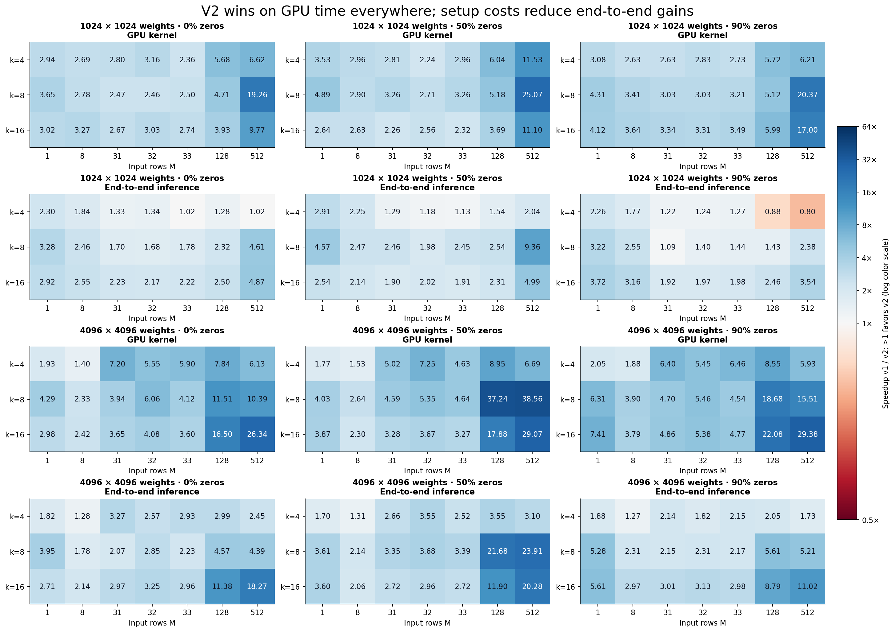
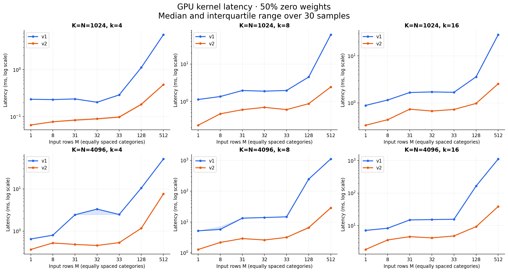
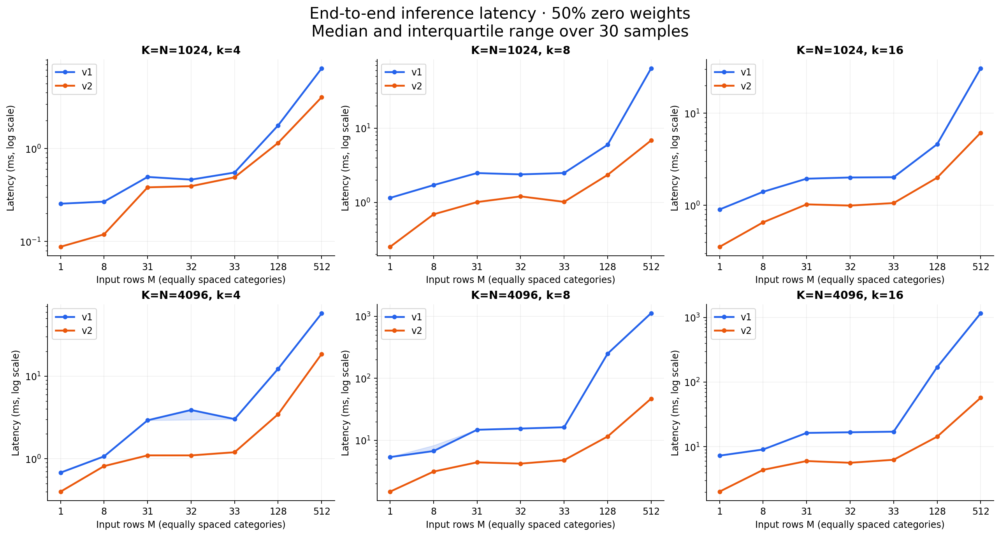
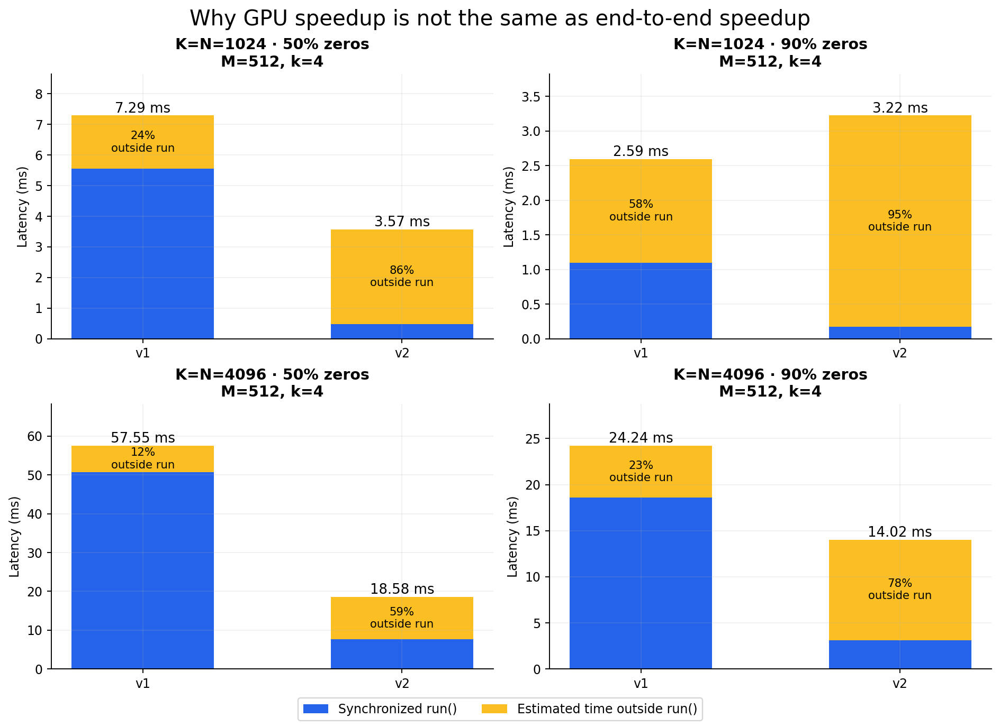
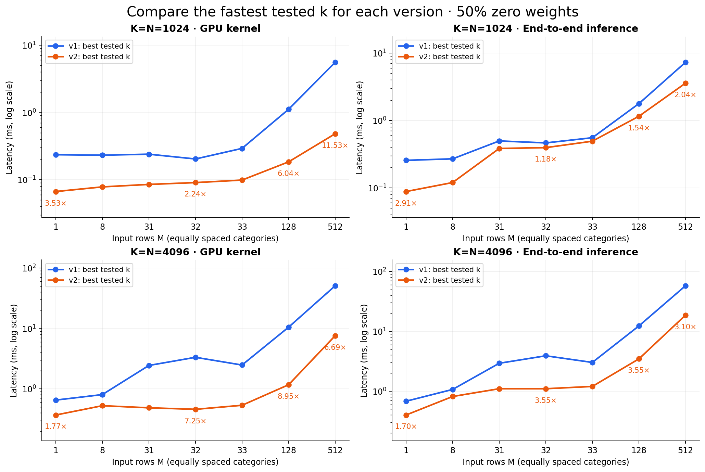

# SPR GPU comparison analysis

Run: RTX 2080 Ti, CUDA 12.9, student cluster job 4443. The GPU and log metadata are read from the supplied result folders.

Validated 22,932 raw rows, 30 samples per inference metric, all 252 version/configuration PASS entries, no failed cases, and four successful profiler invocations. Recomputed medians match timing_summary.csv. Maximum recorded initial validation error: 0.000239441. Large cases use sampled reference validation.

| Timing | V2 wins | Median speedup across workloads | Speedup range |
|---|---:|---:|---:|
| GPU kernel | 126/126 | 3.93× | 1.40–38.56× |
| Synchronized run() | 126/126 | 3.94× | 1.40–39.19× |
| End-to-end inference | 124/126 | 2.45× | 0.80–23.91× |

## Interpretation

- GPU speedup includes changes to launch geometry and warp utilization as well as memory access. These timings alone cannot isolate coalescing as the cause. V2 also improves M=1, where there are no neighboring input rows to coalesce across.
- The two end-to-end regressions occur at K=N=1024, k=4, 90% zeros: M=128 gives 0.877× and M=512 gives 0.804×. The inexpensive kernel is outweighed by setup/conversion/transfer costs.
- The largest matched-k GPU speedup is 38.56× at M=512, K=N=4096, k=8, 50% zeros: 1112.69 ms versus 28.86 ms. End-to-end is 1127.18 ms versus 47.15 ms (23.91×).
- That largest ratio is not the fastest configuration. At the same M, shape and sparsity, k=4 gives end-to-end 57.55 ms versus 18.58 ms (3.10×). Use the best-k plot when comparing tuned versions.
- Median(end-to-end) minus median(run) estimates combined non-run cost. It does not isolate transpose, allocation, upload or download, and separately timed phases can experience different cache states.
- The 31/32/33 input-row cases show warp-boundary behavior, but differences can also reflect cache footprint, alignment and measurement variation. Bands are IQR within one run, not cross-job uncertainty.
- Nsight reports are present, but are binary .ncu-repz files. No custom roofline or DRAM-traffic conclusion is inferred without exporting the hardware metrics. Their logs warn of uncontrolled caches; profile timings should not be merged with ordinary benchmark samples.
- Results use repeated identical inputs, no explicit cache flush, and unlocked GPU clocks. Repeat on additional seeds/jobs before treating the largest ratios as stable general performance.

## Figures

### 01_speedup_overview

All 126 workloads, for GPU-event and end-to-end timing. Numbers are ratios of medians; red means v2 is slower.

### 02_gpu_event_latency

Absolute latency matters: a large speedup at one k does not imply that k is fastest. Bands show sample IQR, not confidence intervals.

### 03_end_to_end_wall_latency

Absolute latency matters: a large speedup at one k does not imply that k is fastest. Bands show sample IQR, not confidence intervals.

### 04_setup_and_transfer_cost

Yellow is median(end-to-end) minus median(run), an estimate including allocations and transfers plus v2 input transposition. It is not a direct measurement of transpose alone.

### 05_best_k_comparison

Each point independently selects the lowest median among k=4,8,16. Labels show v1/v2 speedup; selection uses the same timing samples, not a separate tuning run.

