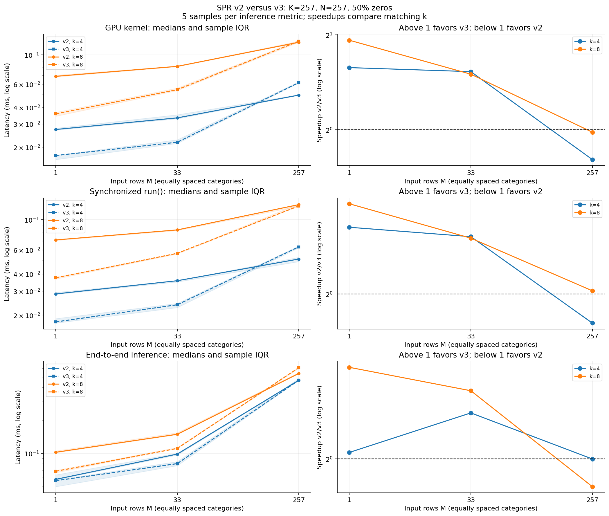

# SPR v2 versus v3

6 workloads per version; 5 samples per inference metric.

Hardware, compiler, commands and source hashes are in ../environment.json.

Speedup = median(v2) / median(v3); above 1 favors v3.

| Timing | v3 wins | Median speedup across workloads | Range |
|---|---:|---:|---:|
| GPU kernel | 4/6 | 1.515x | 0.804–1.924x |
| Synchronized run() | 5/6 | 1.492x | 0.814–1.893x |
| End-to-end inference | 4/6 | 1.126x | 0.886–1.492x |

Interpretation:

- GPU-event time isolates the instrumented launch; synchronized run() includes host launch/synchronization overhead.
- End-to-end time includes bind, run and finish, including input transposition, allocations and transfers.
- Matched-k plots compare the same SPR width. best_k.csv selects the fastest tested k separately for each version using these same timing samples; it is not held-out tuning.
- IQR bands describe variation within this run, not confidence intervals across jobs. Inputs repeat, caches are warm and GPU clocks are not locked.
- Dedicated correctness suites check every output on their test cases. Large benchmark cases use sampled FP64 reference checks and a full finite-output scan.

