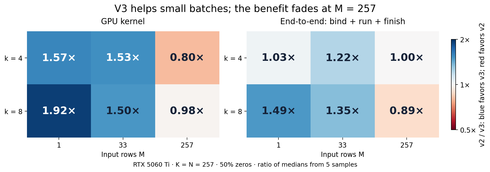
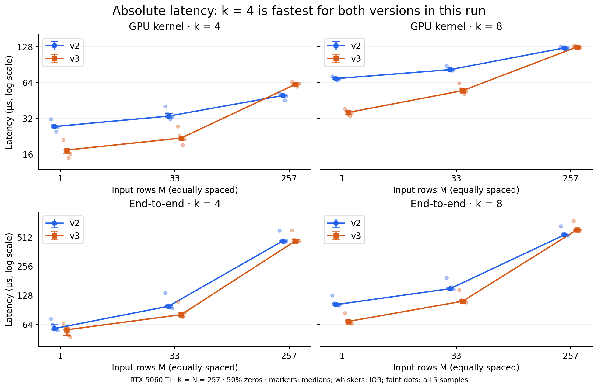
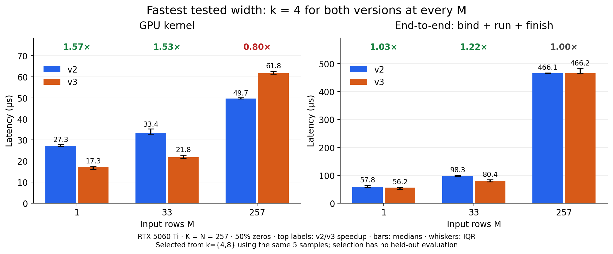

# V3 versus v2: interpretation of job 4493

This is the **smoke run**, not the full campaign: RTX 5060 Ti, CUDA compiler 12.9, sm_120, K=N=257, 50% zero weights, seed 42, M={1,33,257}, k={4,8}, five warm-ups and five samples per inference metric.

V2 launches 128 input rows per CUDA block with one thread per SPR task. V3 launches 32 input rows by eight helpers (256 threads per block), with independent segment sums and cooperative output reductions. This is one fixed configuration, not a helper-count tuning sweep.

## Validation

Both versions passed 195 common correctness cases and 108 GPU edge cases (303 per version). Edge cases include two input bindings and three runs per binding. All 12 sanitizer invocations reported zero errors; racecheck also reported zero warnings. All 12 benchmark executions passed reference validation. The largest smoke workloads use sampled reference checks; all outputs are checked for finiteness. These results support correctness on the tested cases, not a proof for every shape.

Recomputed medians and quartiles match the recorded timing summary. All source-snapshot hashes match environment.json. There are 192 raw records: 12 preparation observations and 180 inference samples.

## Measured results

Speedup = median(v2)/median(v3); values above 1 favor v3.

| M | k | GPU v2 (µs) | GPU v3 (µs) | GPU speedup | End-to-end v2 (µs) | End-to-end v3 (µs) | End-to-end speedup |
|---:|---:|---:|---:|---:|---:|---:|---:|
| 1 | 4 | 27.26 | 17.31 | 1.575× | 57.77 | 56.16 | 1.029× |
| 1 | 8 | 68.90 | 35.81 | 1.924× | 102.16 | 68.49 | 1.492× |
| 33 | 4 | 33.38 | 21.82 | 1.529× | 98.34 | 80.45 | 1.222× |
| 33 | 8 | 81.98 | 54.62 | 1.501× | 149.28 | 110.86 | 1.347× |
| 257 | 4 | 49.66 | 61.76 | 0.804× | 466.05 | 466.24 | 1.000× |
| 257 | 8 | 124.80 | 127.07 | 0.982× | 537.69 | 606.99 | 0.886× |

## Interpretation

1. **Small-batch kernel improvements are clear within this run.** At M=1 and M=33, GPU-event speedups range from 1.50× to 1.92×. The kernel IQRs do not overlap in these four cases. The plausible explanation is more parallelism within a task when input-row parallelism is scarce; the data do not isolate reduction speed from changed launch geometry, metadata access or other effects.

2. **The improvement does not extend to every larger-batch case.** At M=257,k=4, GPU latency rises from 49.664 to 61.760 µs: v3 takes 24.4% longer. IQRs are separated. At k=8, 124.800 versus 127.072 µs is close to parity and the IQRs overlap. Synchronized run() slightly favors v3 there, so the roughly 2% GPU-event difference is not a robust basis for choosing a version.

3. **End-to-end time matters.** At M=1,k=4, a 1.57× GPU gain becomes 1.03× end-to-end: the median improves by only 1.612 µs. At M=33, end-to-end gains are 1.22× (k=4) and 1.35× (k=8). At M=257,k=4, total time is effectively tied. At M=257,k=8, v3 takes 12.9% longer end-to-end despite near-equal kernel time. Allocation, transposition and transfer costs are included, but not separately measured; this regression cannot be attributed specifically to the reduction or transpose.

4. **Compare absolute latency as well as matched-k speedup.** k=4 has the lowest measured kernel and end-to-end median for both versions at every M here. The largest matched-k speedup (1.92× at M=1,k=8) is not the fastest configuration: v3 k=8 takes 35.808 µs, versus 17.312 µs for v3 k=4 and 27.264 µs for v2 k=4. Comparing the fastest tested k for each version yields GPU speedups of 1.57×, 1.53× and 0.80× at M=1,33,257; end-to-end speedups are 1.03×,1.22× and 1.00×.

5. **Likely scaling tradeoff, not a proven bottleneck.** V3 trades row parallelism for helper parallelism, adds shared-memory traffic and barriers at every tree level, and leaves merges sequential. Once v2 has enough independent input rows, these costs can outweigh the cooperation benefit. Kernel timings alone do not prove occupancy, memory-bandwidth or barrier-stall causes; profiling is needed to separate them.

## Next experiment

Run `sbatch --cpus-per-task=3 bench/gpu_compare.sbatch full` in the existing cluster project. The full campaign adds K=N=1024/4096, M=8/31/32/128/512, k=16 and 0%/90% zeros, with 30 samples. Keep the current v3 launch fixed first. Then compare 2/4/8/16 helpers on promising workloads. Do not infer an optimal helper count or a dispatch threshold from this one fixed eight-helper smoke run.

Five samples, one seed and one job give limited evidence for stability, especially for small differences. Inputs repeat, caches are not flushed, and clocks are not locked. IQRs show within-run sample spread, not confidence intervals across jobs.
