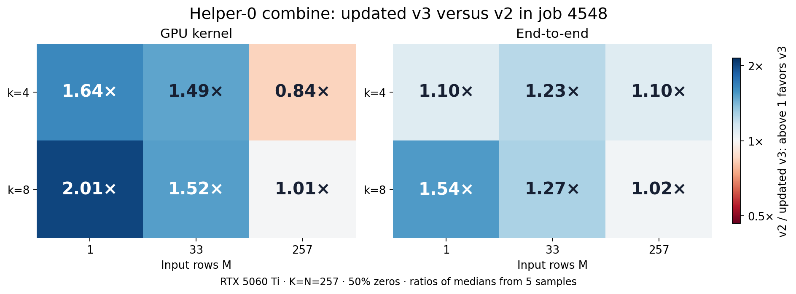
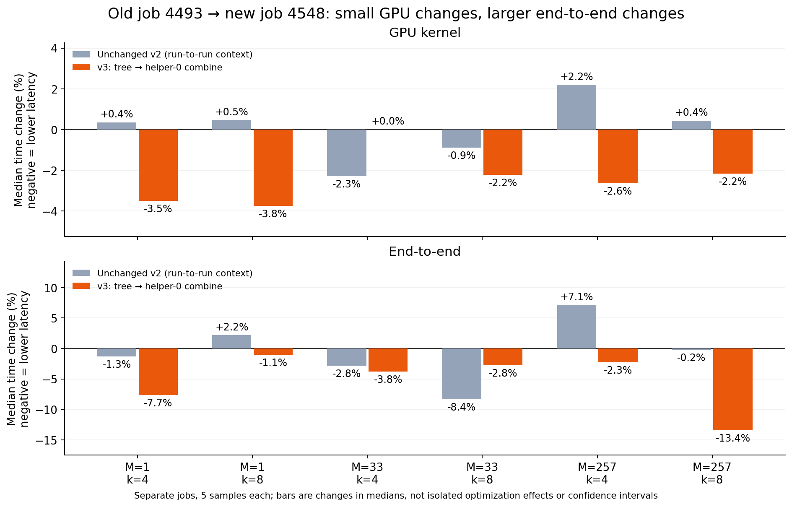

# Interpretation: helper-0 final reduction experiment (job 4548)

The updated v3 retains cooperative contribution accumulation and replaces the shared-memory tree reduction with a sequential combine of eight partial sums by helper 0. It removes three intermediate block-wide barriers per level, leaving two; it is not free of all reduction or synchronization.

## Scope and validation

Both jobs are smoke runs: RTX 5060 Ti, CUDA compiler 12.9, sm_120, K=N=257, 50% zeros, M={1,33,257}, k={4,8}, seed 42, five warm-ups and five samples per inference metric.

Each version passed 303 reference/edge cases in job 4548. All 12 sanitizer invocations reported zero errors, with zero racecheck warnings. All 12 benchmark executions passed validation and failures.json is empty. Medians and quartiles were recomputed from 192 raw records. Source-snapshot hashes match metadata in both runs; only gpu/spr/spr_v3.cu changed among the recorded source files. V2 and the benchmark harness are unchanged.

Large smoke workloads (M=257) use sampled FP64 reference checks plus a finite-output scan; the dedicated correctness suites check every output of their own test cases.

## Updated v3 against v2: same-job comparison

Speedup is median(v2)/median(updated v3), above 1 favoring updated v3.

| M | k | GPU v2 (µs) | GPU updated v3 (µs) | GPU speedup | End-to-end speedup |
|---:|---:|---:|---:|---:|---:|
| 1 | 4 | 27.360 | 16.704 | 1.638× | 1.099× |
| 1 | 8 | 69.216 | 34.464 | 2.008× | 1.540× |
| 33 | 4 | 32.608 | 21.824 | 1.494× | 1.235× |
| 33 | 8 | 81.248 | 53.408 | 1.521× | 1.269× |
| 257 | 4 | 50.752 | 60.128 | 0.844× | 1.096× |
| 257 | 8 | 125.344 | 124.320 | 1.008× | 1.021× |

- Small-batch GPU wins remain: 1.64–2.01× at M=1 and 1.49–1.52× at M=33.
- At M=257,k=4, updated v3 takes 60.128 µs versus v2's 50.752 µs, or 18.5% longer. The former 24.4% gap narrows but the larger-batch kernel regression remains.
- At M=257,k=8, GPU-event medians differ by only 0.8% in v3's favor, while synchronized run() is 1.3% slower. Treat this as near parity rather than a convincing win.
- End-to-end medians favor v3 in all six cases, from 1.02× to 1.54×. These include allocations, transposition and transfers, so they are not pure reduction-kernel effects. The M=1,k=4 end-to-end IQRs overlap.
- k=4 is still the fastest tested width for both versions at every M. The 2.01× matched-k speedup at M=1,k=8 is not the fastest configuration.

## Did removing the tree help relative to the previous v3?

| M | k | Previous v3 GPU (µs) | Updated v3 GPU (µs) | v3 time change | Unchanged v2 time change |
|---:|---:|---:|---:|---:|---:|
| 1 | 4 | 17.312 | 16.704 | -3.51% | +0.35% |
| 1 | 8 | 35.808 | 34.464 | -3.75% | +0.46% |
| 33 | 4 | 21.824 | 21.824 | +0.00% | -2.30% |
| 33 | 8 | 54.624 | 53.408 | -2.23% | -0.90% |
| 257 | 4 | 61.760 | 60.128 | -2.64% | +2.19% |
| 257 | 8 | 127.072 | 124.320 | -2.17% | +0.44% |

The observed GPU change is modest: five medians improve by about 2.2–3.8%, and one is unchanged. Old/new v3 GPU IQRs overlap in five of six cases. The unchanged v2 GPU baseline also moves by approximately -2.3% to +2.2%, which is comparable to these gains. This suggests a small potential benefit, not a demonstrated stable speedup from the optimization alone.

The jobs report the same hostname and GPU model, but different PCI bus addresses (06:00.0 versus 04:00.0). The metadata does not establish that the same physical GPU was used. Clocks were not locked, and this is a cross-job comparison, not an interleaved comparison of the two v3 implementations.

The end-to-end changes need particular care:

- At M=257,k=4, v3 changes from 466.235 to 455.556 µs (-2.3%), while unchanged v2 changes from 466.050 to 499.265 µs (+7.1%). Much of the new 1.10× v2/v3 end-to-end ratio comes from the baseline becoming slower.
- At M=257,k=8, v3 end-to-end time falls 13.4%, but its GPU time falls only 2.2%. That larger total-latency improvement cannot be assigned solely to the removed reduction barriers; setup/transfer phases and cross-run variation were not separately measured.

## Interpretation and next step

The simpler final combine is a reasonable candidate to keep for further testing, but it has not solved v3's larger-batch kernel disadvantage. Parallel segment sums and contribution accumulation remain, as do global scratch accesses, two block-wide barriers per level and sequential merges. Their relative runtime costs have not been profiled; fewer barriers alone do not guarantee proportional speedup.

For a clean next experiment, compile both old and updated v3 from their recorded snapshots and benchmark them in the same allocation, alternating their order with at least 30 samples and repeated measurement batches. Keep M,K,N,k,helper count and timing boundaries fixed. Then run the larger full campaign. Do not select an optimal helper count or universal dispatch threshold from this five-sample, one-shape experiment.

Additional latency/IQR plots are in K257_N257_z0.5.png. The reproducible numerical comparison is old_new_comparison.csv.
