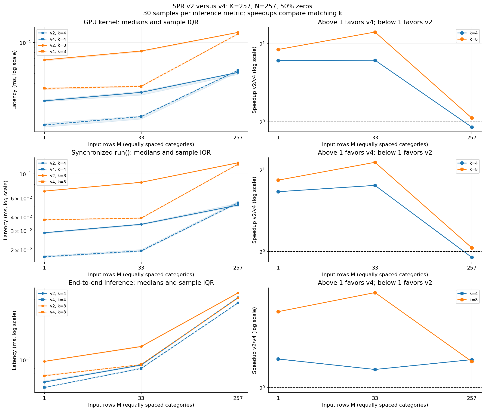

# SPR v2 versus v4

6 workloads per version; 30 samples per inference metric.

Hardware, compiler, commands and source hashes are in ../environment.json.

Speedup = median(v2) / median(v4); above 1 favors v4.

| Timing | v4 wins | Median speedup across workloads | Range |
|---|---:|---:|---:|
| GPU kernel | 5/6 | 1.723x | 0.955–2.216x |
| Synchronized run() | 5/6 | 1.708x | 0.952–2.134x |
| End-to-end inference | 6/6 | 1.155x | 1.097–1.620x |

Interpretation:

- GPU-event time isolates the instrumented launch; synchronized run() includes host launch/synchronization overhead.
- End-to-end time includes bind, run and finish, including input transposition, allocations and transfers.
- Matched-k plots compare the same SPR width. best_k.csv selects the fastest tested k separately for each version using these same timing samples; it is not held-out tuning.
- IQR bands describe variation within this run, not confidence intervals across jobs. Inputs repeat, caches are warm and GPU clocks are not locked.
- Dedicated correctness suites check every output on their test cases. Large benchmark cases use sampled FP64 reference checks and a full finite-output scan.

