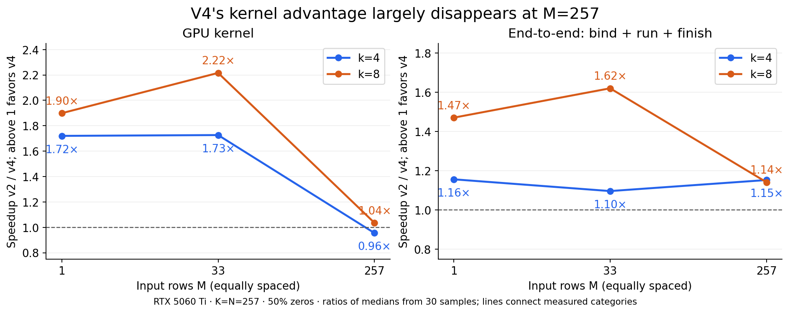
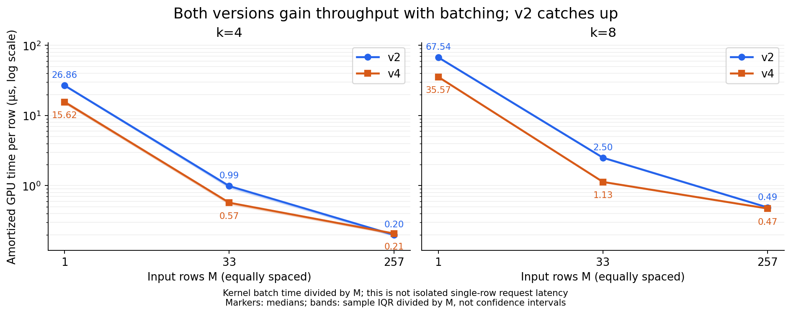

# V2 versus v4: interpretation of job 4561

The kernel speedup does diminish at the largest tested M, although it is not monotonically decreasing: M=33 is similar to or better than M=1. These are smoke results on an RTX 5060 Ti: K=N=257, 50% zeros, seed 42, M={1,33,257}, k={4,8}, five warm-ups and 30 samples per inference metric.

## Validation

Both versions passed 195 common correctness cases and 108 edge cases each. All 12 sanitizer invocations reported zero errors, and racecheck reported zero warnings; all 12 benchmark executions passed their reference checks. Source-snapshot hashes were verified, and all medians/quartiles were recomputed from 1092 raw records. M=257 benchmark cases use sampled FP64 reference checks plus a full finite-output scan; the dedicated correctness suites check every output on their test cases.

## Same-job results

Speedup = median(v2)/median(v4), above 1 favors v4.

| M | k | GPU v2 (µs) | GPU v4 (µs) | GPU speedup | End-to-end speedup |
|---:|---:|---:|---:|---:|---:|
| 1 | 4 | 26.864 | 15.616 | 1.720× | 1.157× |
| 1 | 8 | 67.536 | 35.568 | 1.899× | 1.471× |
| 33 | 4 | 32.544 | 18.848 | 1.727× | 1.097× |
| 33 | 8 | 82.544 | 37.248 | 2.216× | 1.620× |
| 257 | 4 | 50.976 | 53.376 | 0.955× | 1.153× |
| 257 | 8 | 125.424 | 121.152 | 1.035× | 1.142× |

At M=1 and M=33, v4's kernel is 1.72–2.22× faster than v2. At M=257,k=4, v4 takes 53.376 µs versus 50.976 µs: 4.7% longer. At k=8 it takes 121.152 versus 125.424 µs: 3.4% less time. Thus the larger-batch outcome is close to parity, with a small loss at k=4 and a small gain at k=8. Synchronized run() shows the same direction in both cases.

k=4 remains the fastest tested k for both versions at every M, for both GPU and end-to-end timings. A larger matched-k speedup at k=8 does not imply that k=8 has the lowest latency.

## Why increasing M changes the tradeoff

V2 gives one thread to each (input row, SPR block) task, with 128 rows per CUDA block. V4 gives eight helpers to each task and tiles 32 input rows per CUDA block. Helpers compute independent segment sums, synchronize once, then helper 0 evaluates the whole tree.

At small M, v2 has few active input-row lanes. V4 creates additional parallel work across segments, which can expose more concurrent work and memory accesses. At larger M, v2 can already use independent rows to populate warps and hide latency. V4 still reserves eight helpers per row, but seven do no tree evaluation after the segment phase. The resource and scheduling tradeoff is therefore less favorable. This is an explanation consistent with the mapping and measured trend, not a measured attribution to occupancy, bandwidth or a specific stall source.

For example, at M=1, v2's (128,1) block assigns one thread to a valid row, while v4's (32,8) block assigns eight. At M=257, v2 launches three 128-thread blocks per SPR block, while v4 launches nine 256-thread blocks. Both ultimately evaluate 257 row trees per SPR block, but v4 has many more helper threads associated with that work.

Both kernels improve in amortized time per row as M grows. For k=4, v2 goes from 26.864 µs/row at M=1 to approximately 0.198 at M=257; v4 goes from 15.616 to approximately 0.208. V4 is not becoming inefficient simply because it processes more rows; v2 catches up by using its row-level parallelism. Batch time divided by M describes throughput, not individual request latency.

## End-to-end latency is a separate result

End-to-end medians favor v4 in all six cases, by 1.10–1.62×. This trend is not monotonic in M: for k=4 the ratios are 1.16×, 1.10× and 1.15×; for k=8 they are 1.47×, 1.62× and 1.14×.

At M=257,k=4, v4's end-to-end time is 457.880 µs versus v2's 527.875 µs, despite v4's slower kernel. The total-latency advantage comes from outside the kernel timing boundary; allocations, transposition and transfers are included but not measured individually. Both implementations have the same general bind/finish behavior, so the difference should not be described as a demonstrated transpose optimization.

The unchanged v2 end-to-end baseline also shifts between jobs: relative to job 4548 it is 5.7% slower at M=257,k=4 and 11.4% slower at M=257,k=8. These variations reinforce the need to distinguish measured total latency from an isolated algorithm improvement.

## Context from the preceding v3 experiment

The preceding v3 job 4548 used the same input shapes, seed, v2 source and benchmark harness, but only five samples and a separate allocation. Cross-job v3/v4 comparisons are descriptive, not a controlled isolation of the code change.

| M | k | Prior v3 GPU (µs) | Current v4 GPU (µs) | v4 time change |
|---:|---:|---:|---:|---:|
| 1 | 4 | 16.704 | 15.616 | -6.5% |
| 1 | 8 | 34.464 | 35.568 | +3.2% |
| 33 | 4 | 21.824 | 18.848 | -13.6% |
| 33 | 8 | 53.408 | 37.248 | -30.3% |
| 257 | 4 | 60.128 | 53.376 | -11.2% |
| 257 | 8 | 124.320 | 121.152 | -2.5% |

The strongest difference is M=33,k=8: 53.408 µs for prior v3 versus 37.248 µs for v4, a 30.3% reduction in GPU time. At M=257,k=4 the v2/v3 kernel gap had been 18.5%; it is now 4.7% for v2/v4. This makes segment-only cooperation a useful next candidate, while M=1,k=8 shows a small cross-job regression versus v3 and prevents claiming universal dominance.

## Practical conclusion

The evidence supports experimenting with a workload-dependent helper count rather than increasing helpers for every M. Keep the current v4 as a small-batch candidate; for larger M compare helper counts 1,2,4,8 with otherwise identical metadata and mapping. Then test the full K,N,k,sparsity sweep before selecting a dispatch rule. Larger K can increase segment-sum work, larger N supplies more independent SPR blocks, and larger k changes the tree size. A crossover cannot be inferred from M alone or located precisely between just 33 and 257.

The 30 samples provide more within-job observations than previous smoke runs, but this remains one matrix shape, one sparsity, one seed and one job. Sample IQRs are not cross-job confidence intervals, and no hardware-counter profile was collected.
