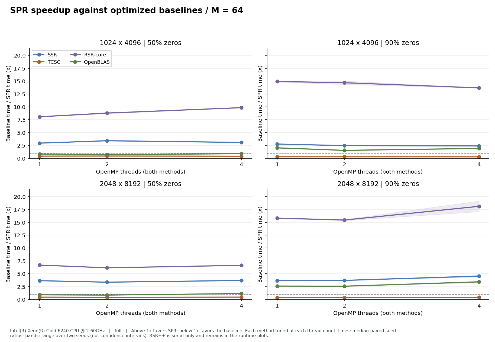
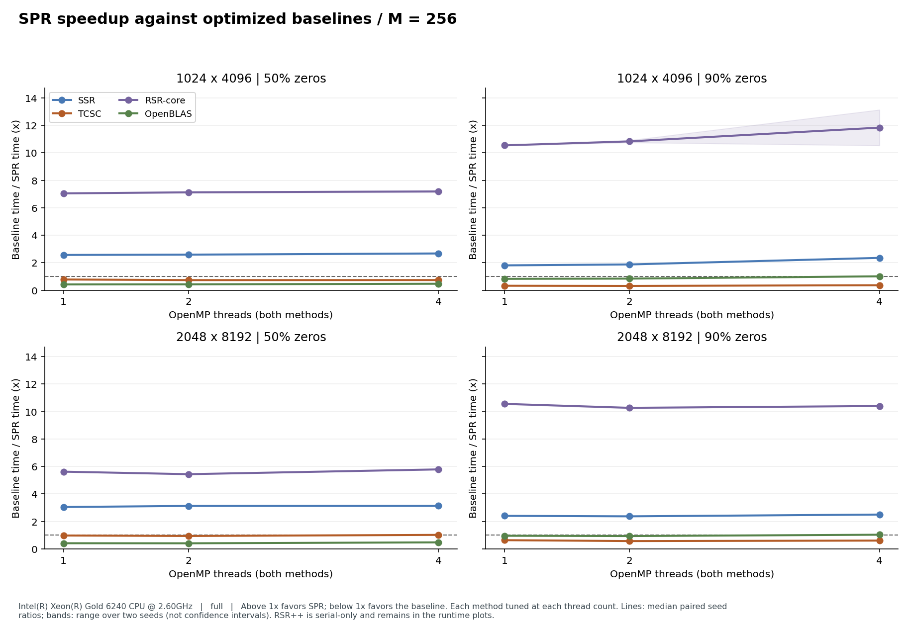
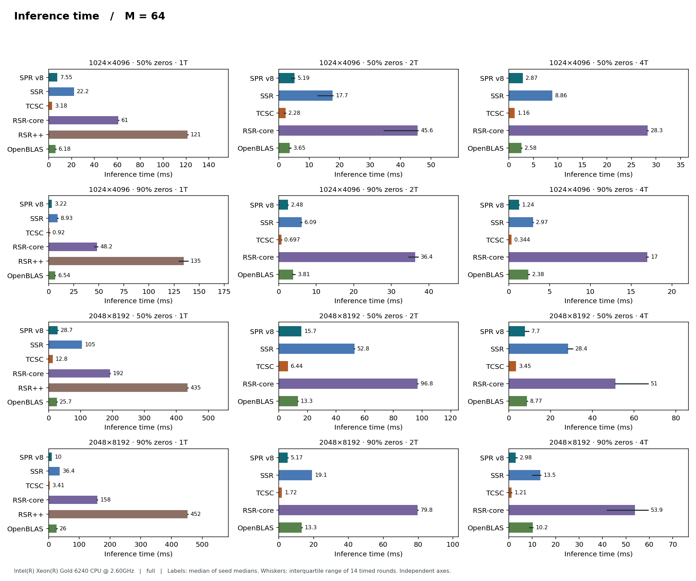
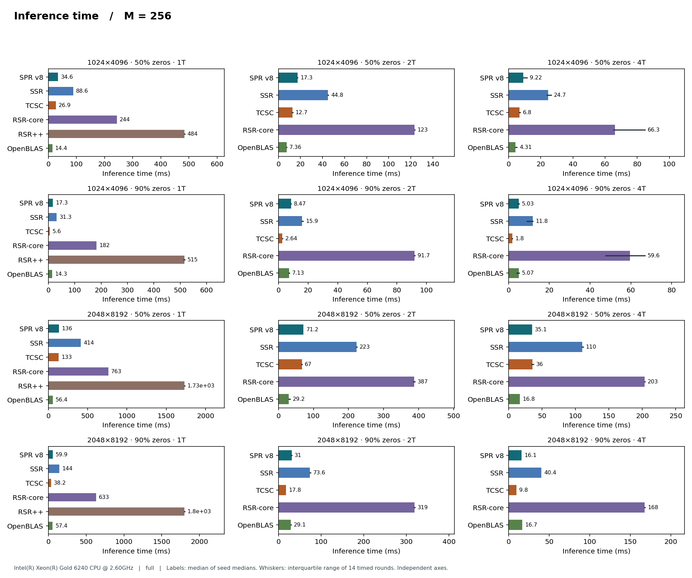
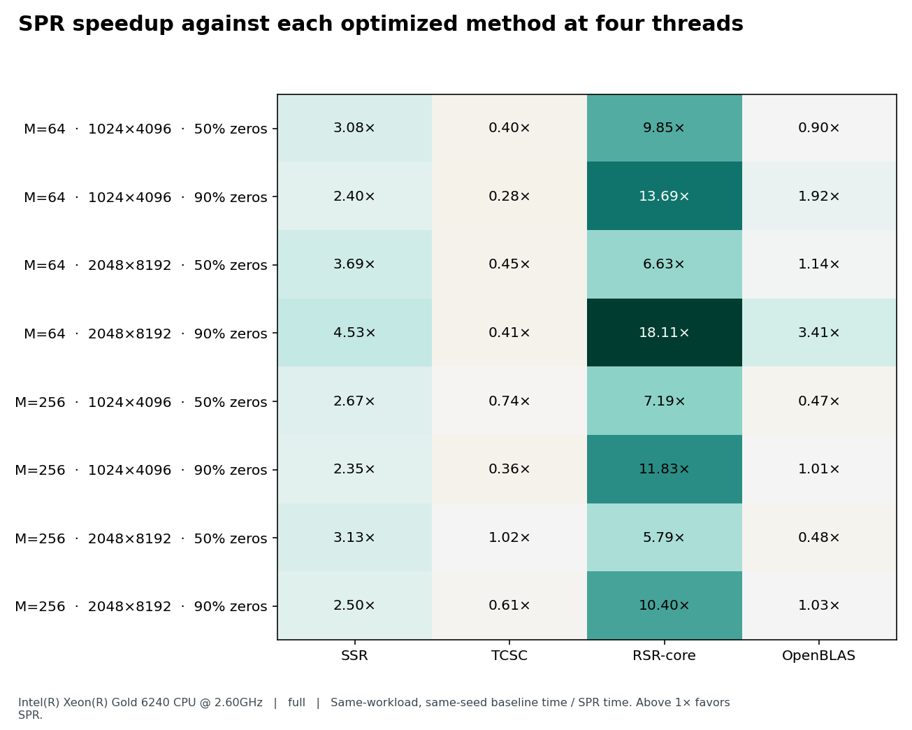
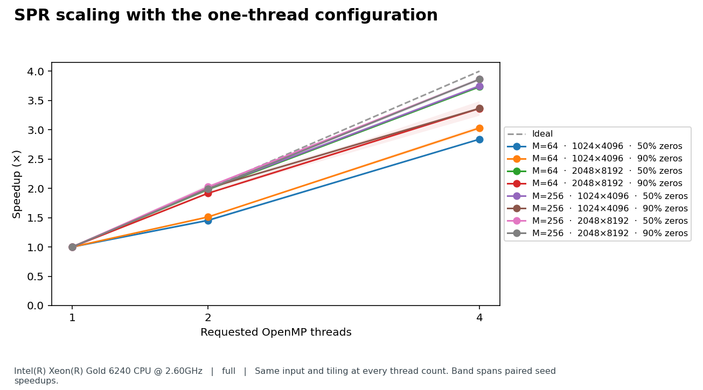
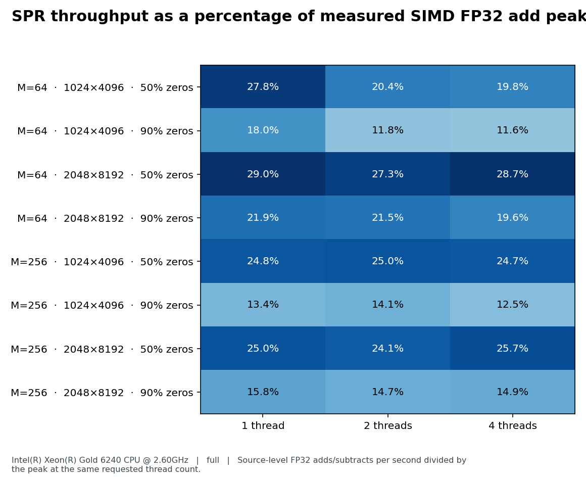
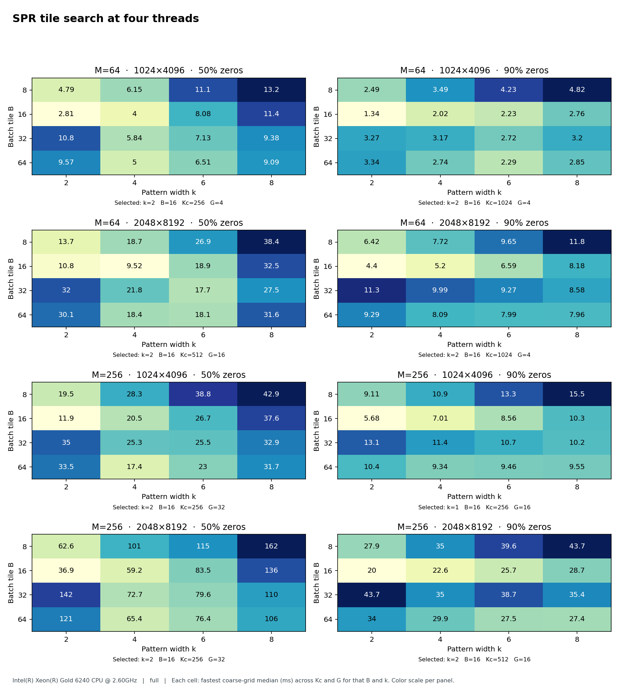

# CPU benchmark: Xeon Gold 6240

Measurements from cluster job 4329. Saved CSV files retain timings, selected kernels and tuning parameters.

## Speedup curves

Both methods use the same number of threads. Above 1 means SPR is faster; below 1 means the baseline is faster. Each method uses its selected configuration for that workload and thread count. Lines show the median of same-seed time ratios; bands span the two evaluation seeds, not a confidence interval. RSR++ was measured only at one thread and is shown in the runtime plots.




## Original campaign figures








## Reproduce

From the repository root, with Python, NumPy and Matplotlib installed:

```sh
python3 bench/campaign_plots.py results/xeon-gold-6240
```

The script regenerates all figures from saved measurements without running kernels.
Use --out path/to/plots to choose a different output directory.
selected.csv records exact winning kernels and parameters; evaluation.csv contains held-out measurements; tuning.csv contains search measurements.

For presentations, the same script also exports individual vector PDF and PNG panels into plots/slide_panels/. These can be arranged independently in LaTeX instead of shrinking composite figures.
